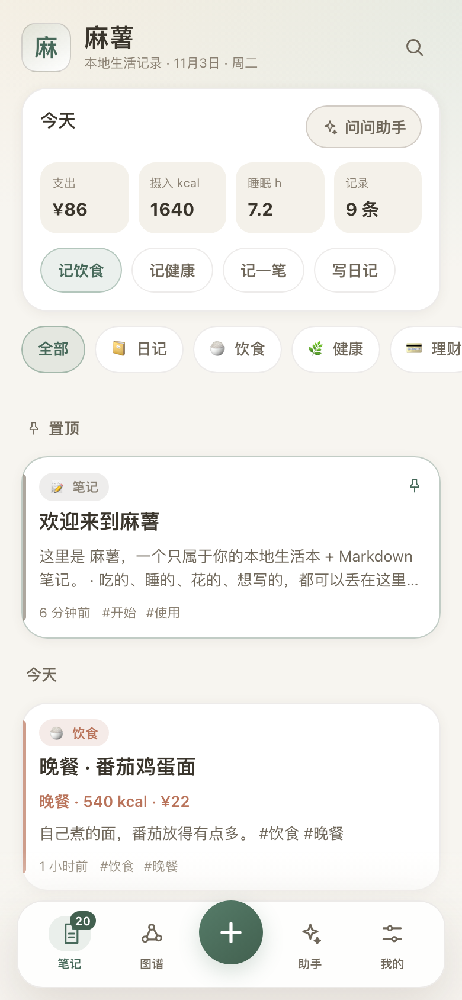
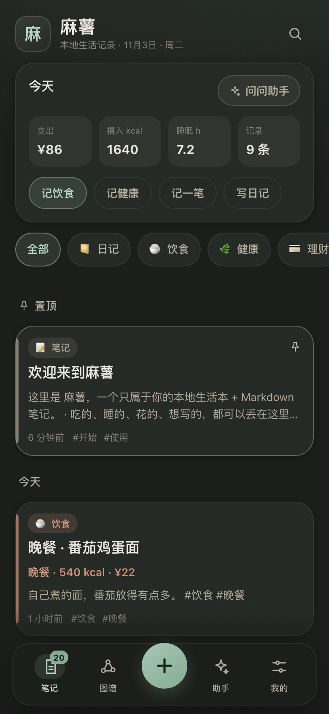
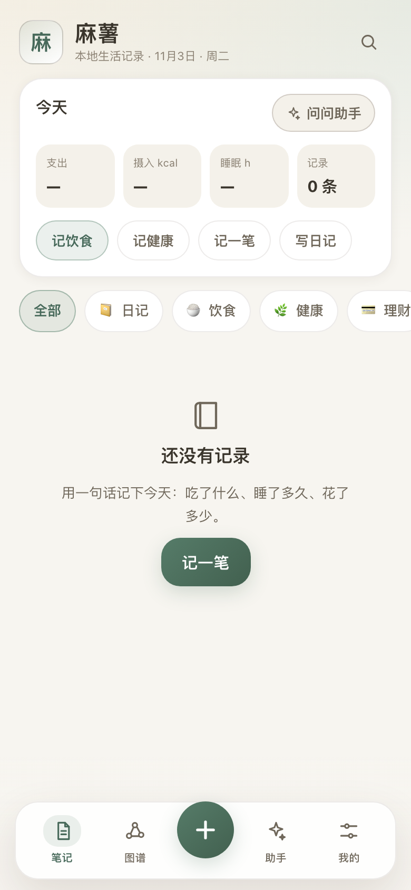

# 麻薯

**把想法揉成一颗颗软乎乎的麻薯。**

一个本地优先的**生活记录 + Markdown 笔记本**：饮食、健康、收支、日记和普通笔记放在同一个地方，彼此用链接连成一张可以自己动手编辑的图；内置助手完全离线，不需要账号，也不需要服务器。

**在线试用**：<https://frank-max610.github.io/mashu-notes/>
**仓库**：[github.com/Frank-max610/mashu-notes](https://github.com/Frank-max610/mashu-notes) · 版本 **v0.3.0**

[](https://frank-max610.github.io/mashu-notes/)
[](LICENSE)
[](https://www.typescriptlang.org/)
[](https://react.dev/)

---

## 为什么做这个项目

- **生活记录不该散在五个 App 里。** 午饭在记账 App、睡眠在健康 App、想法在备忘录——一天结束时，谁也拼不回完整的一天。
- **数据应该属于自己。** 不需要账号，不上传云端，断网也能用，随时可以完整导出。
- **记录工具可以安静一点。** 不追求提醒你打卡的紧迫感，也不追求花哨的仪式感；打开、记一句、合上。
- **记录和想法应该长在一起。** 一笔午饭、一次睡眠、一个灵感、一篇长笔记，都值得被 `[[链接]]` 和图谱连起来，而不是各过各的。
- **助手应该透明。** 内置助手只做可解释的本地规则计算，不把你的生活数据发给任何模型或服务。

## 名字的由来

> **麻薯，是软糯的糯米团子。**

生活记录也像一颗颗麻薯：一顿午饭、一晚睡眠、一笔支出、一句心情，单独看都很小，放在一起就有了形状。用 `[[双向链接]]` 把它们串起来，再用生活图谱摊开，就是一碗属于自己的日子。

产品名就叫**麻薯**（拼音 Mashu）。底层的代码标识和存储键沿用早期版本的内部代号 `mochi`，只为兼容旧数据；界面和文档里只叫「麻薯」。

## 功能

### 生活记录

| 功能 | 说明 |
| --- | --- |
| **五种记录类型** | 日记、饮食、健康、理财、普通笔记。列表与图谱按类型着色，一眼分清。 |
| **结构化字段** | 饮食（餐次、热量、菜品、金额）、健康（体重/睡眠/步数/饮水/运动/心情）、理财（收支方向、金额、分类）、日记（心情）。字段都参与统计与助手回答。 |
| **一句话快速记录** | 打开「＋记录」，写「午饭牛肉面 32 元 620 大卡」，本地解析成一条饮食记录；也可以选类型后补填快捷字段。保存前能看到解析结果和置信度。 |
| **今天概览** | 首页显示今天的支出、摄入、睡眠和记录条数，并有「记饮食 / 记健康 / 记一笔 / 写日记」快捷入口。 |
| **按天整理** | 记录按本地日期分组，支持置顶、按类型筛选；每条记录带类型徽章和结构化摘要。 |

### 内置本地助手

| 功能 | 说明 |
| --- | --- |
| **完全离线** | 规则式启发算法（`src/lib/agent.ts`），在同一台设备上解析和计算；不调用云端 API，不联网，数据不出浏览器。 |
| **对话式记录** | 说「奶茶 18 元」「体重 52.4 kg」「今天有点累」，助手会解析成草稿；保存前必须确认，不会静默写入。 |
| **今天 / 本周小结** | 能回答支出、收入、饮食、热量、睡眠、体重、步数、饮水、心情、记录条数等问题，也可以做本周复盘和简单建议。 |
| **快捷问题** | 面板提供常用问题胶囊，回答里附带可继续追问的建议，全部由本地数据生成。 |
| **可定制人设** | 在「我的」里改名字、换头像（预设头像或自定义 emoji），保存在本机。 |

> 说明：它是**规则式本地助手，不是大语言模型**。回答范围和措辞由代码中的规则决定，因此可预测、可测试；路线图中包含可选的本地小模型适配器。

### 可编辑的生活图谱

| 功能 | 说明 |
| --- | --- |
| **一张生活图** | 每条记录是一个节点，按类型着色；`[[wiki 链接]]`、手动连线、同一天的记录串联，都会变成图上的边。 |
| **直接编辑** | 点节点选中，打开记录信息面板改标题、类型、结构化字段和手动连线；也可以在面板里删除。 |
| **拖动与保存** | 拖动节点调整位置，位置会归一化保存，下次打开仍在你放的地方；「重新布局」可清除手动位置。 |
| **添加与连线** | 工具栏切到「添加」，点空白处新建一条记录；切到「连线」，依次点两个节点建立手动连接。 |
| **缩放与适配** | 双指/滚轮缩放、拖动画布、适应画布；图例会标出当前出现的类型和「未创建」的幽灵节点。 |

### 笔记与通用能力

| 功能 | 说明 |
| --- | --- |
| **双向链接与反向链接** | 正文里写 `[[记录名]]` 或 `[[记录名\|别名]]`；每条记录自动生成出链与反向链接。目标不存在时显示为「未创建」。 |
| **标签与全文搜索** | `#标签` 自动索引并聚合成筛选胶囊；搜索支持标题、正文、`#标签` 过滤，结果按相关度排序并显示命中片段。 |
| **Markdown 编辑与预览** | 编辑 / 预览切换，支持标题、强调、删除线、引用、列表、任务清单、表格、代码块等常用语法；原始 HTML 不执行。 |
| **本地优先存储** | IndexedDB 持久化，不可用时回退 localStorage；断网可读写，没有后端参与。 |
| **导入与导出** | 导出 JSON（vault v2，无损、可再导入）或 Markdown 合集；导入支持 JSON 的合并 / 整库替换，并兼容 0.1.x / 0.2.x 的旧备份。 |
| **PWA 与离线** | Web App Manifest + Service Worker：生产构建在 HTTPS / localhost 下缓存应用壳，可离线打开；支持添加到主屏幕。 |
| **浅色 / 深色主题** | 安静的「纸与墨」配色：浅色是暖纸色 + 鼠尾草绿点缀，深色是墨色夜间模式，也可跟随系统。 |
| **移动优先的安静界面** | 底部胶囊导航「笔记 / 图谱 / ＋记录 / 助手 / 我的」，首页搜索图标进入搜索；40px 以上触控目标、安全区适配、克制动效并尊重「减少动态效果」系统设置、正文对比度达到 WCAG AA。 |

## 截图

> 整体是「纸与墨」的安静风格：暖纸色底、鼠尾草绿强调、按记录类型分配的柔和分类色，动效克制。以下截图由 `npm run screenshots` 驱动本机 Chrome 生成，视觉以实际运行效果为准。

| 首页 · 今天概览 | 生活图谱 | 本地助手 |
| :---: | :---: | :---: |
|  |  |  |

| 快速记录 | 编辑器（预览） | 编辑器（编辑） |
| :---: | :---: | :---: |
|  |  |  |

| 搜索 | 我的 · 助手人设 | 深色主题 |
| :---: | :---: | :---: |
|  |  |  |

| 空状态 |
| :---: |
|  |

## 快速开始

环境要求：**Node.js 22 LTS 或更新**。Vite 8 的最低要求是 Node 20.19，但测试运行器 Vitest 5 需要 Node 22.12+，CI 也使用 Node 22；建议直接用当前 LTS。

```bash
# 1. 获取代码
git clone https://github.com/Frank-max610/mashu-notes.git
cd mashu-notes
npm install

# 2. 启动开发服务器（http://localhost:5173）
npm run dev

# 3. 生产构建，产物在 dist/
npm run build

# 4. 预览生产构建（http://localhost:4173）
npm run preview
```

不想装环境？直接打开[在线演示](https://frank-max610.github.io/mashu-notes/)就能用。

首次打开会写入一组演示记录（生活记录 + 笔记，含链接、标签和示例数据），方便你马上看到今天概览、图谱和助手的效果。在「我的」里清空后不会再自动生成。

常用命令一览：

| 命令 | 作用 |
| --- | --- |
| `npm run dev` | 开发服务器，默认 `http://localhost:5173`，同时监听局域网（`--host`） |
| `npm run build` | 先跑 TypeScript 类型检查，再用 Vite 构建到 `dist/` |
| `npm run preview` | 本地预览 `dist/`，默认 `http://localhost:4173` |
| `npm run share` | 在局域网分享 `dist/`（默认 `0.0.0.0:4173`，可用 `-- --port 4174` 换端口），打印访问地址和二维码 |
| `npm run typecheck` | 只做 TypeScript 类型检查 |
| `npm test` | 运行 Vitest 单元测试（纯逻辑层） |
| `npm run test:watch` | 以 watch 模式运行测试 |
| `npm run icons` | 重新生成 `public/icons/` 下的 PWA 图标（需要 Python 3 + Pillow） |
| `npm run qr` | 生成局域网访问地址的二维码 PNG（`docs/screenshots/lan-qr.png`） |
| `npm run screenshots` | 用本机 Chrome 无头模式重新截取 README 截图（需要 Chrome） |

## 在手机上试用（局域网）

不用部署、不用装 App：把构建产物放到局域网里，手机扫终端二维码就能打开。

```bash
npm run build
npm run share
```

`npm run share` 会在 `0.0.0.0:4173` 上托管 `dist/`，并在终端打印本机地址、**局域网 URL 和二维码**（端口被占用时可以 `npm run share -- --port 4174`）。手机和电脑连同一个 Wi-Fi，用相机扫码（或手动输入局域网地址）即可打开。它只提供静态文件，不接触你的记录。

Windows / Linux 上同样可用；如果只需要一张可分享的二维码图片，构建并托管后运行 `npm run qr` 会生成 `docs/screenshots/lan-qr.png`。

终端输出形如：

```text
  麻薯 已启动

  本机访问    http://localhost:4173
  手机访问    http://192.168.1.23:4173   （手机与电脑需连接同一 Wi-Fi）

  用手机扫描二维码打开：
  ██▀▄…（二维码）…
  按 Ctrl+C 停止服务。
```

> **HTTP-on-LAN 注意事项**
>
> 生产构建会注册 Service Worker（`public/sw.js`）缓存应用壳，但浏览器只在 `https://` 或 `localhost` 等安全上下文允许注册。通过 `http://192.168.x.x:4173` 访问时可以正常使用（在线模式），断网后无法重新打开；**记录仍然保存在手机浏览器自己的 IndexedDB 里，不会上传到电脑或任何服务器**。部署到 HTTPS 后即可获得完整离线体验。

### 添加到主屏幕

**iOS（Safari）**

1. 用 Safari 打开麻薯（局域网地址或部署后的 HTTPS 地址）。
2. 点底部工具栏的「分享」按钮。
3. 选择「添加到主屏幕」。
4. 确认名称后点「添加」，之后从主屏幕图标启动。

**Android（Chrome / Edge）**

1. 用浏览器打开麻薯。
2. 点右上角菜单（⋮）。
3. 选择「添加到主屏幕」（部分浏览器显示为「安装应用」）。
4. 确认后从主屏幕启动。

添加到主屏幕后，应用会以 `standalone` 模式启动，看不到浏览器地址栏；在 HTTPS / localhost 下配合 Service Worker 还能离线打开。通过局域网 HTTP 添加的只是快捷入口。不同设备的记录库互相独立：手机上的记录只存在手机浏览器里。

## 数据与隐私

- **助手完全本地。** `src/lib/agent.ts` 与 `src/lib/insights.ts` 是纯函数：输入你的记录和当前时间，输出解析结果或小结。不联网、不调用模型、不上传任何内容。
- **没有后端、没有账号、没有遥测。** 应用不依赖服务端接口，也不会发起统计或 API 请求；运行时的网络访问只来自加载应用自身的静态文件，以及你在笔记里主动写入的外链/图片。
- **所有记录保存在浏览器本地。** 默认 IndexedDB（schema v2），不可用时回退 localStorage；旧版本的本地数据会自动迁移。首次加载会请求持久化存储权限，降低被自动清理的概率。
- **每个设备、每个地址都是独立的库。** `localhost`、`127.0.0.1`、局域网 IP、部署域名在浏览器看来是不同的 origin，数据互不相通；固定使用同一个地址访问。
- **应用壳缓存不含记录。** Service Worker 只缓存 HTML/CSS/JS 等静态资源，IndexedDB / localStorage 中的生活记录不会被写入缓存。
- **生活数据比较敏感。** 收支、体重、睡眠都是私人信息；浏览器存储不是端到端加密的，请像保护任何本地文件一样保护设备，并定期导出备份。
- **备份靠导出。** 「我的」页可随时导出 JSON（无损、可再导入）或 Markdown 合集；清除浏览器站点数据会删除记录。
- **局域网分享只暴露应用文件。** `npm run share` 提供的是静态构建产物，记录数据始终留在各自设备的浏览器里。

更完整的说明见 [docs/PRIVACY.md](docs/PRIVACY.md)。

## 项目结构

```text
mashu-notes/
├── .github/workflows/
│   ├── ci.yml                    # GitHub Actions：typecheck + test + build
│   └── deploy-pages.yml          # 构建并发布到 GitHub Pages
├── docs/
│   ├── ARCHITECTURE.md           # 架构、数据流与扩展点
│   ├── PRIVACY.md                # 隐私说明
│   └── screenshots/              # 应用截图（npm run screenshots / npm run qr 生成）
├── public/
│   ├── icons/                    # PWA 图标（npm run icons 生成）
│   ├── manifest.webmanifest      # PWA 清单
│   └── sw.js                     # Service Worker：应用壳离线缓存
├── scripts/
│   ├── make_icons.py             # 生成 PWA 图标（Python + Pillow）
│   ├── qr.mjs                    # 生成局域网访问二维码 PNG
│   ├── screenshots.mjs           # 用本机 Chrome 截取 README 截图
│   └── serve.mjs                 # 局域网托管 dist/ + 二维码
├── src/
│   ├── components/               # 可复用 UI（TabBar、NoteCard、GraphView、CaptureSheet、AgentPanel、NodeEditorSheet…）
│   ├── screens/                  # 页面级组件（笔记/首页、编辑器、我的）
│   ├── lib/                      # 核心逻辑（纯函数 + 浏览器适配层）
│   │   ├── types.ts              # 数据模型（Note / NoteMeta / NoteKind / AgentPersona…）
│   │   ├── kinds.ts              # 记录类型词表、颜色、默认标题与摘要
│   │   ├── links.ts              # wiki 链接、标签、反向链接等派生关系
│   │   ├── markdown.ts           # markdown-it 渲染管线
│   │   ├── insights.ts           # 生活记录统计：日/周汇总、分类支出、健康序列
│   │   ├── agent.ts              # 本地助手：自然语言解析、问答与建议（纯规则）
│   │   ├── search.ts             # 全文搜索（纯函数）
│   │   ├── graph.ts              # 生活图谱构建与力导向布局（纯函数）
│   │   ├── db.ts                 # IndexedDB / localStorage 持久化（schema v2）
│   │   ├── store.ts              # useNotes() 单一状态源
│   │   ├── prefs.ts              # 主题、引导标记、助手人设、Note 工厂
│   │   ├── seed.ts               # 首次运行的演示记录
│   │   ├── exportImport.ts       # JSON（vault v2）/ Markdown 导入导出
│   │   ├── format.ts             # 时间 / 字节 / 数字格式化
│   │   └── useRoute.ts           # 轻量 hash 路由
│   ├── styles/
│   │   ├── tokens.css            # 纸与墨色板、类型色、间距、圆角、动效、安全区
│   │   ├── base.css              # reset 与共享基础样式
│   │   └── app.css               # 应用外壳与页面样式
│   ├── App.tsx                   # 应用外壳：路由、主题、快速记录、图谱编辑、助手
│   └── main.tsx                  # React 挂载入口 + Service Worker 注册
├── tests/                        # Vitest 单元测试
├── index.html                    # HTML 入口与 PWA meta
├── package.json
├── tsconfig.json
├── vite.config.ts
├── vitest.config.ts
├── CONTRIBUTING.md
├── LICENSE
└── README.md
```

## 技术选型

| 层面 | 选择 | 原因 |
| --- | --- | --- |
| UI | **React 19 + TypeScript strict** | 组件化、hooks 管理状态；strict 模式把问题挡在编译期 |
| 构建 | **Vite 8** | 快速开发服务器与静态构建；`base: './'` 让产物可部署到任意路径 |
| Markdown | **markdown-it 15** | 可靠、可扩展的 CommonMark 实现；关闭 `html`，从源头避免注入 |
| 存储 | **原生 IndexedDB（schema v2）+ localStorage 回退** | 零额外依赖、容量大；v2 在原库上就地升级，兼容旧备份 |
| 状态 | **单一 `useNotes()` hook** | 内存乐观更新 + 防抖写入，输入不等 I/O |
| 视觉 | **手写 CSS + 设计变量** | 「纸与墨」两套色板和类型色集中在 `tokens.css`；不引入 UI 框架 |
| 图谱 | **Canvas 2D + 确定性力导向布局** | 纯函数布局，支持拖动、添加、连线与位置持久化 |
| 助手 | **纯 TypeScript 规则引擎** | 完全本地、可测试、可解释；不依赖模型或网络 |
| 测试 | **Vitest（node 环境）** | 解析、统计、图谱布局等纯逻辑可直接测 |
| 局域网分享 | **静态文件服务脚本 + qrcode-terminal** | 手机扫码即可试用，无需部署 |
| 部署 | **GitHub Actions → GitHub Pages** | 推送到 `main` 自动构建发布 |

运行时依赖只有 `react`、`react-dom`、`markdown-it` 三个；没有路由库、状态库、UI 框架和后端。

## 部署

- **GitHub Pages（推荐）**：仓库自带 `.github/workflows/deploy-pages.yml`，推送到 `main` 或手动 `workflow_dispatch` 后自动构建并发布，线上地址为 <https://frank-max610.github.io/mashu-notes/>。`base: './'` 让产物在子路径下也能正常加载。
- **任意静态托管**：`npm run build` 后把 `dist/` 上传即可（Vercel、Netlify、Cloudflare Pages 等），不需要服务端环境变量。
- **本机 / 局域网**：见上文 `npm run share`。

## FAQ

### 助手会联网吗？会不会把我的记录发给大模型？

不会。助手是 `src/lib/agent.ts` 里的本地规则引擎：解析、统计、建议都由本机代码完成，没有网络请求，没有模型 API，也不会把记录发送到任何地方。它不是大语言模型，回答范围由规则决定——可预测、可测试，但也因此不如通用聊天模型灵活。

### 能记些什么？

| 类型 | 可以记 | 结构化字段示例 |
| --- | --- | --- |
| 饮食 | 「午饭牛肉面 32 元 620 大卡」 | 餐次、热量、菜品、金额 |
| 健康 | 「体重 52.4 kg」「睡了 7 小时」「走了 8300 步」 | 指标、数值、单位 |
| 理财 | 「地铁 6 元」「工资 8500」 | 收支方向、金额、分类 |
| 日记 | 「今天有点累，但完成了报告」 | 心情 |
| 笔记 | 普通 Markdown 长文、清单、计划 | 标题、正文、标签、链接 |

也可以直接在快速记录里选类型再补字段；所有记录都能在「编辑记录信息」里继续修改。

### 生活图谱怎么改？

- **移动**：直接拖动节点，松手后位置会保存；「重新布局」清空手动位置，回到自动布局。
- **编辑 / 删除**：点一下节点选中，打开记录信息面板，可以改标题、类型、结构化字段和手动连线，也可以删除。
- **添加**：工具栏点「添加」，再点画布空白处，新建一条记录。
- **连线**：工具栏点「连线」，依次点两个节点，建立一条手动连线（与 `[[wiki 链接]]`、同日记录边并存）。
- **缩放**：双指 / 滚轮缩放，拖动画布平移，或用工具栏的放大、缩小、适应画布。

### 如何同步到其他设备？

当前没有云同步。在「我的」里导出 JSON → 用 AirDrop、网盘或聊天工具传到另一台设备 → 在「我的」里导入（合并或替换）。局域网手机打开的是手机自己的独立记录库，不会和电脑同步。同步 / WebDAV / Git 备份在路线图中。

### 会不会丢数据？

记录存在浏览器存储里，正常使用不会丢。风险主要来自手动清除站点数据、隐私/无痕模式、存储空间不足。应用会请求持久化存储权限，并在保存失败时提示导出备份。最稳妥的习惯仍然是**定期导出 JSON 备份**。升级版本时，旧数据库会就地迁移，旧备份也能导入。

### 和 Obsidian 有什么区别？

Obsidian 是通用 Markdown 知识库，插件生态成熟，文件存在本地文件夹里；麻薯更小、更安静，面向「生活记录 + 轻笔记」：饮食、健康、收支、日记有结构化字段和统计，图谱可以直接编辑，助手完全离线。它没有插件生态、没有本地文件夹 vault、没有内置同步。需要文件级 Markdown、插件和多端同步时，Obsidian 仍然更合适。

### 支持哪些 Markdown 语法？

标题、粗体/斜体、删除线、引用、有序/无序列表、任务清单（`- [ ]`，预览中只展示状态）、表格、围栏代码块、行内代码、链接、`[[wiki 链接]]`、`#标签`。出于安全考虑禁用原始 HTML；暂时没有代码高亮、图片上传或文件夹层级（见路线图）。

### 需要联网吗？

不需要后端。麻薯没有服务端调用，运行时逻辑都在浏览器里；开发时的 `npm run dev` 只是本机静态服务器，构建后的 `dist/` 可部署到任意静态托管。生产构建会注册 Service Worker，在 HTTPS / localhost 下首次加载后可离线打开；通过局域网 HTTP 访问时是在线模式，但记录始终保存在本地。

### 我的记录会被上传吗？

不会。仓库里没有遥测、分析、广告或崩溃上报代码，也没有写死的第三方接口。只有你在笔记里主动写入的外链或网络图片，才会在预览时由浏览器去加载。

### 如何删除所有数据？

「我的」页提供「清空全部记录」；也可以在浏览器设置里清除该站点数据。删除前请先导出 JSON 备份，操作不可恢复。

## 路线图

已完成（0.3.0）：

- [x] 生活记录：五种类型 + 结构化字段 + 一句话快速记录
- [x] 首页「今天」概览与按天分组的记录列表
- [x] 内置本地助手：解析、今天/本周小结、建议、快捷问题
- [x] 助手人设：名字与头像可自定义
- [x] 可编辑生活图谱：类型着色、拖动持久化、添加、手动连线、重新布局
- [x] 记录信息面板（标题 / 类型 / 结构化字段 / 手动连线 / 删除）
- [x] 存储 schema v2 与 vault v2 导入导出，兼容旧版本备份
- [x] 「纸与墨」视觉重设计：浅色 / 深色主题、类型色、克制动效
- [x] 双向链接、标签、全文搜索、Markdown 编辑 / 预览
- [x] PWA、GitHub Pages 在线演示与自动部署

计划中：

- [ ] 可选的本地小模型（local LLM）适配器：仍在设备本地运行、默认关闭
- [ ] 云同步 / WebDAV / Git 备份
- [ ] CSV 导入（记账 / 健康数据）
- [ ] 图表页：支出结构、体重 / 睡眠趋势
- [ ] 导入 Markdown 合集（目前导入只支持 JSON）
- [ ] 本地文件夹 vault（File System Access API）
- [ ] 图片 / 附件上传
- [ ] 代码块语法高亮
- [ ] 插件系统与主题
- [ ] 英文界面（i18n）
- [ ] UI 交互测试（当前测试集中在纯逻辑层）

## 参与贡献

欢迎 issue、PR 和真实使用反馈。开发环境、代码风格、测试要求和提交规范见 [CONTRIBUTING.md](CONTRIBUTING.md)。

```bash
npm run typecheck && npm test && npm run build
```

## 许可证

[MIT](LICENSE) © 2026 Mashu contributors

---

## English

**Mashu (麻薯)** is a local-first life journal and Markdown notebook. Meals, health, spending, diaries and free-form notes live together, connected by `[[wiki links]]` and a hand-editable life graph — with a fully offline, rule-based assistant built in.

- Five record kinds — diary, food, health, finance and plain notes — with structured metadata (meal, calories, amount, metric/value/unit, mood, occurrence time).
- One-line quick capture ("lunch beef noodles, ¥32, 620 kcal") parsed locally; a "Today" card on the home screen; records grouped by day.
- The built-in agent runs entirely on-device heuristics: capture parsing, today/week summaries, advice and prompt chips. No network, no model API, no telemetry. It is deliberately rule-based and explainable, not an LLM.
- An editable life graph: kind-coloured nodes, wiki + manual + same-day edges, draggable nodes with saved positions, add/connect modes and a node editor sheet.
- Notes keep the Markdown editor, backlinks, tags, full-text search and PWA/offline support; storage upgrades in place to schema v2 and imports vault v2 (older backups are welcome).
- Calm "paper & ink" design with light/dark themes, a sage accent and restrained motion.

Try the [live demo](https://frank-max610.github.io/mashu-notes/) or run it on a phone over your LAN: `npm run build && npm run share`, then scan the QR code on the same Wi-Fi. MIT licensed — read [docs/ARCHITECTURE.md](docs/ARCHITECTURE.md) for the design and [CONTRIBUTING.md](CONTRIBUTING.md) to get involved.
