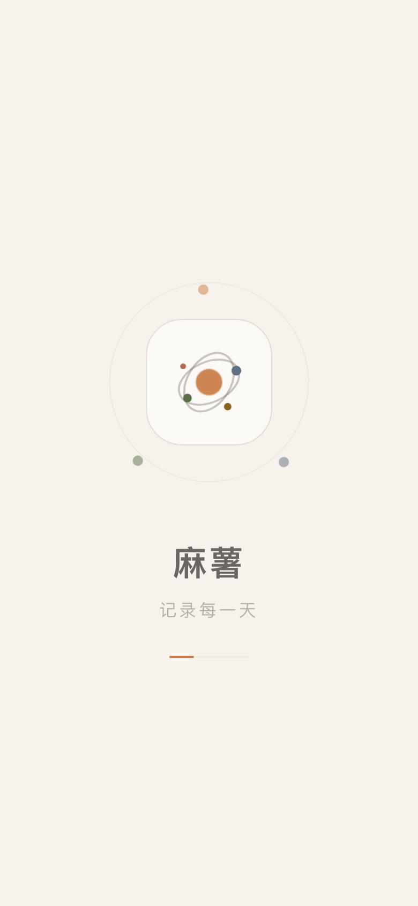
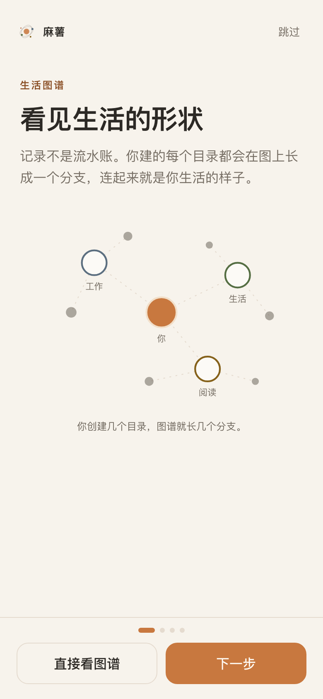
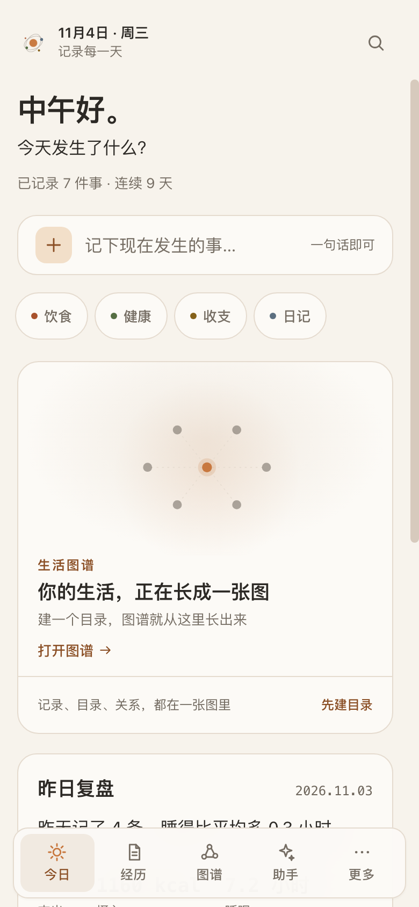
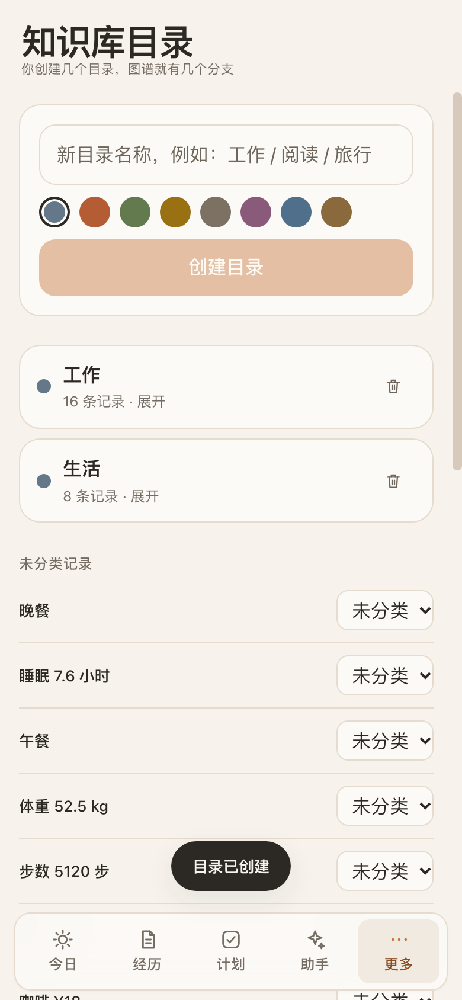
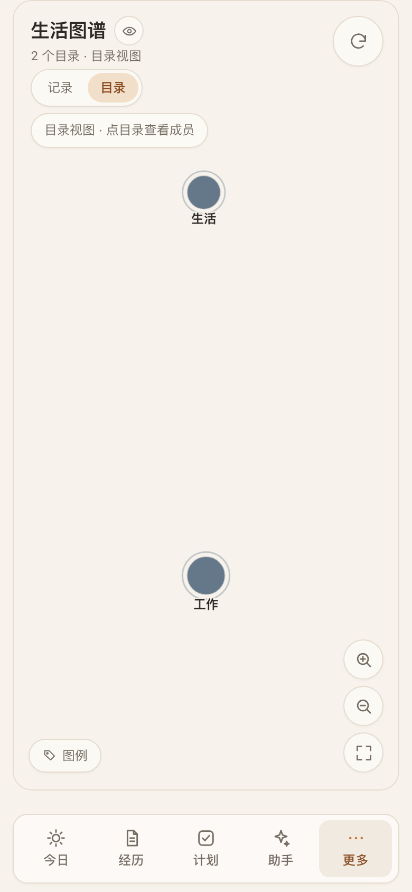
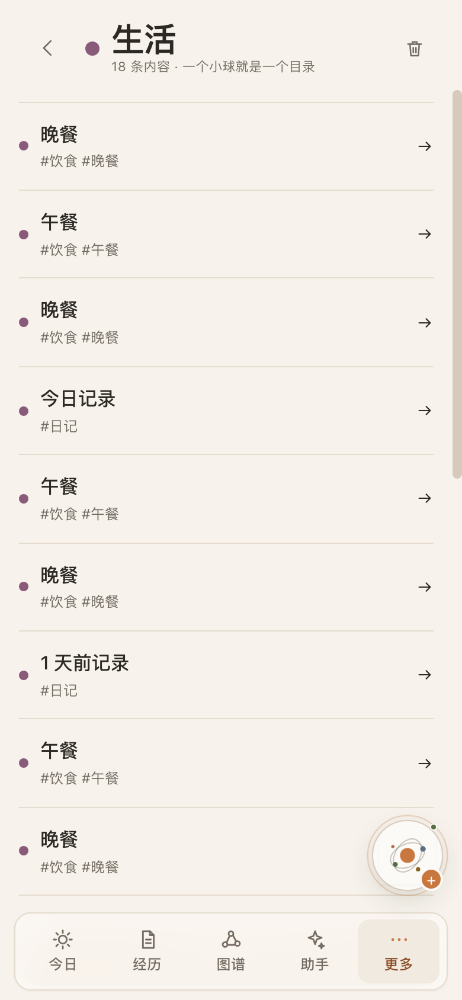
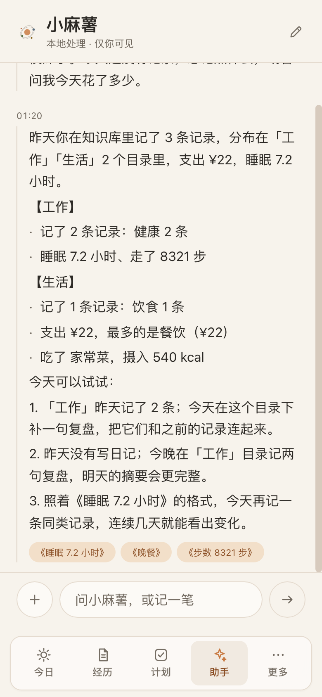
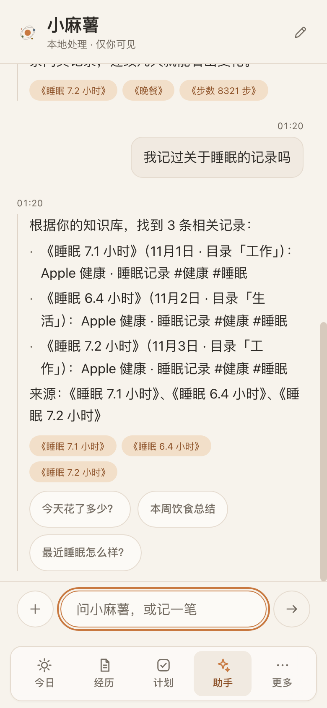

# 麻薯

**记录、连接、理解。**

一个本地优先的 **iPhone 生活操作系统**：饮食、健康、收支、日记和 Markdown 笔记放在一起，以安静的「今日」驾驶舱开始，用生活图谱把一切连起来。**没有服务器，也没有账号**——装到主屏幕后，断网也能用。

**在线试用（请用 Safari 打开）**：<https://frank-max610.github.io/mashu-notes/>
**仓库**：[github.com/Frank-max610/mashu-notes](https://github.com/Frank-max610/mashu-notes) · 版本 **v1.2.0**

[](https://frank-max610.github.io/mashu-notes/)
[](LICENSE)
[](https://www.typescriptlang.org/)
[](https://react.dev/)

---

## v0.9 LifeOS：安静一点，活一点

0.9 按照《麻薯_LifeOS_UIUX重设计方案》做了一次完整的 UI/UX 重构（Warm Minimalism × Living Data）：

- **去掉了卡通吉祥物**，改用 **Mochi Node** 品牌符号：一颗暖色主节点 + 几颗卫星节点 + 细轨道，出现在页头、助手人设、App 图标、favicon 和启动图里；不再有脸、表情或水果帽。
- **变小、变安静**：首屏 hero 收敛到 34–38px，只留一个高权重动作（一句话记录条）；不再用大卡片墙、渐变标题、发光或霓虹。
- **今日是驾驶舱**：问候 + 一句话输入 + 昨日复盘 + 轻量建议；图谱和时间线后来成为第一视觉锚点。不抢注意力。
- **图谱后来成为主角**：0.9 时还是 note graph；1.2 已改为纯目录网络（每个小球=目录，见 v1.2 章节）。
- **阅读优先的编辑器**：打开是渲染后的 Markdown，只有进入编辑才出现工具栏和原文；所有操作收进「更多」。
- **渐进式快速记录**：一句话是主角，一行紧凑解析卡确认，结构化字段藏在「展开详情」里，固定 52px 的保存按钮。
- **消费级设置**：助手 / 外观 / 数据与隐私 / Apple 健康 / 自动化 / 高级设置 / 关于；技术细节默认折叠在「高级设置」里。
- **暖色调深色主题**：深色是暖炭色 `#171410` + 柔杏色高光，不是冷黑或紫黑；浅色仍是暖纸色 `#f7f3ec`。

设计系统（源：设计文档 §04，全部写在 `src/styles/tokens.css`）：

| 维度 | 浅色 | 深色 |
| --- | --- | --- |
| 背景 / 表面 | `#F7F3EC` / `#FCFAF6` | `#171410` / `#211D18` |
| 次级表面 | `#F1EAE1` | `#28221D` |
| 正文 / 次级文字 | `#2C2925` / `#756D63` | `#F3ECE4` / `#B8ABA0` |
| 边框 | `#E5DBCF` | `#3B332C` |
| 主色 / 主色浅底 | `#C8783F` / `#F2DFC9` | `#E6A062` / `#463024` |
| 危险色 | `#B34B36` | `#D56A56` |

- **字体与字号**：Display 34–38 / H1 28–32 / H2 20–22 / Body 16–17 / Meta 12–13 / 数据用 mono 13–15；不再使用圆体或宋体衬线。
- **布局**：页面左右 20px，区块间距 28–36；卡片圆角 16–20，按钮 14–16；阴影几乎不可见，没有 glow/neon。
- **控件**：只有 chip 是胶囊；底部导航固定 66px，激活项是浅色块；一套统一线性图标。
- **分类色**（日记 `#65788A`、饮食 `#B45D35`、健康 `#627A4E`、财务 `#9A7112`、笔记 `#7D7164`）只用于节点、标签和小面积状态，不做大面积背景。
- **动效**：页面进入 220–320ms、按压 120–180ms、sheet ease-out、图谱 settle 1–2s；全部尊重 `prefers-reduced-motion`。
- **空状态**：只保留一个目标 + 一个 CTA，不堆插画和口号。

## v1.0 LifeOS 知识图谱 + 有依据的助手

1.0 在安静界面之上把「知识库」变成产品核心：**目录 → 图谱 → 汇总 → 有依据的助手**。这一版仍然没有服务器、没有账号、没有模型 API。

- **知识库目录**：从「更多 → 知识库目录」创建/命名/选颜色的目录笔记（`meta.directory`）；普通记录通过 `dirId` 归入目录。目录页显示成员数、展开成员、把记录移入/移出；删除目录时成员只会变成未分类，**永远不会删除记录**。目录笔记本身也是普通笔记，导出/导入备份会自动包含它们。
- **图谱进入知识库**：1.0 第一次把用户目录放进图谱；1.2 进一步修正为**纯目录网络**（见下方 v1.2 章节），记录不再出现在图上。目录仍由「更多 → 知识库目录」创建/颜色/移入移出；删除目录只解除归属，记录永不删除。
- **每日汇总**：助手每天可以基于**昨天**生成一次汇总，按知识库目录分组（未分类排最后），每节 2–3 条具体 highlights，附一句总结与 2–3 条从事实推导出的建议；`sourceIds` 指向真实记录。历史存在本地 `mashu.digest.v1`（新→旧、按 dateKey 去重、最多 14 条）；计划 `mashu.digest.schedule.v1` 默认**开启、每天 08:00**。应用在选定时间之后打开时自动生成（每天一次），也可以在「更多 → 设置 → 自动化 → 立即生成今日汇总」手动触发，汇总会以一条助手消息出现并带来源 chips。
- **有依据的助手**：助手先查你的知识库（`src/lib/knowledge.ts`：确定性的 CJK bigram 检索；目录笔记、归档、计划条目不进入语料）。lookup 会引用真实记录并给出 source ids；统计类回答会写「依据是「你的 N 条记录」」并列出底层记录；没有相关记录时返回明确拒绝「你的知识库里没有找到与「X」相关的记录。可以先在经历库记一条，或换个关键词。」，**绝不编造**。来源 chips 《记录标题》可点击打开本地记录；记一笔和 help 流程保持原样。
- **零服务器诚实说明**：没有后台任务或真正的远程推送。汇总只在应用打开后按本机时间生成；想要准点提醒，用 iOS「快捷指令 → 自动化 → 每天」打开麻薯——这是系统能力，不是服务器。
- **导航变化**：底部导航是 **今日 / 经历 / 图谱 / 助手 / 更多**；图谱是主 tab；知识库目录、设置、计划及个人画像 / 健康数据 / 理财 / 模板 / 归档 / 附件等 LifeOS 模块都在「更多」里。

## v1.1 图谱优先的第一印象

用户反馈「图谱是最大卖点却被埋起来了」；1.1 把图谱变成打开应用后第一眼看到的东西，并减少首屏的碎片：

- **启动 splash**：每次冷启动先显示居中的 Mochi Node + 轨道节点 + 「麻薯」+ slogan「记录每一天」+ 进度线，约 **1.6s** 后自动进入（`prefers-reduced-motion` 下 **450ms**）。不联网、不请求额外资源。
- **首次 4 屏导览**：splash 之后只出现一次（`mashu.onboarded.v1` 不存在时）。第一屏就是图谱承诺「生活图谱 / 看见生活的形状」，配大型 hub-and-branch 插画与「你创建几个目录，图谱就长几个分支」；之后是「一句话记录」「目录由你决定」「有依据的助手」。支持跳过 / 上一步 / 下一步，第一屏有次要 CTA「直接看图谱」（完成并跳到图谱），最后一屏主 CTA「开始记录」（完成并回到今日）。
- **图谱成为主 tab**：底部导航是 **今日 / 经历 / 图谱 / 助手 / 更多**，图谱在中间；**计划移入「更多」**，设置、知识库目录与其余模块也仍在「更多」。
- **今日首屏更聚焦**：hero + 一句话记录 + 4 个快捷 chips，然后第一视觉锚点是大型 **图谱 teaser 卡**（迷你 hub/branch SVG、生活图谱标签、目录/记录数量文案、「打开图谱」CTA；没有目录时显示「先建目录」），接着是紧凑的昨日复盘卡，最后只保留最近 **3 条记录**。移除了独立的指标区、7 日 sparkline 区块和长今日时间线；header 副标题是「记录每一天」。
- **可重复查看**：更多 → 新手导览可重播；`?nointro=1` 会跳过 splash 和导览（截图/自动化用）。

## v1.2 图谱是目录网络

1.2 修正了图谱的模型：**图谱不是「每条记录一个节点」的 note graph，而是一张目录网络**。

- **每个小球 = 一个目录/生活领域**：身体健康、工作、学习、理财、生活……你创建多少目录，图上就有多少小球；整张网络代表「你」。小球的大小反映该目录下的内容量/连接度，标签是目录名。
- **图上的中心是装饰性的「你」**：当至少有 2 个目录时，画布中心会出现一个小的「你」节点，用细线把所有小球连成一张个人网络；它不是记录，也不能编辑。
- **图上没有记录节点**：不显示单独记录，也没有「记录 / 目录」切换、没有添加/连线工具。点小球会进入该目录的内容页（`#/directories/:id`），查看成员、打开记录或删除目录；详细内容都在那里编辑，而不在图上。
- **首次 5 个模板目录**：全新 vault 会种下 身体健康 / 工作 / 学习 / 理财 / 生活 五个可删除的模板目录，并把演示记录自动归档进去，所以第一次打开图谱就是活的。你可以改名或删除；删除目录只会把成员移出目录，不会删除记录。
- **悬浮小助手**：一个可拖动、记住位置的小球（使用你在「助手」里设置的头像/名字）；**点一下 = 快速记录，长按 = 打开助手**。它只在非图谱/非编辑器页面出现，位置存本地 `mashu.floatagent.v1`；可从「更多 → 设置 → 助手」换名字/头像。
- **自动整理**：新记录会按类型、内容和目录名匹配到最合适的目录，并 toast 显示去向；「更多 → 设置 → 自动化 → 记录自动收进图谱」可开关（`mashu.autofile.v1`，默认开）。显式从某个目录「记一笔」时以该目录为准；计划/模板类记录不会被自动归档。
- **今日 teaser**：文案改为「N 个目录，组成你的生活网络 / 每个小球是一个目录，点开编辑内容」，计数所有目录；图谱仍是底部主 tab（今日 / 经历 / 图谱 / 助手 / 更多）。

## 没有服务器，也没有账号

- **整个应用就是一组静态文件。** 推送到 `main` 后，GitHub Actions 自动构建并发布到 GitHub Pages；GitHub 只是**免费的静态托管**，维护者不做任何服务器运维（没有 VPS、没有数据库、没有后台进程）。
- **装到主屏幕，就装到了手机上。** 用 Safari 打开演示链接 → 分享 → 「添加到主屏幕」。首次加载完成后，应用壳由 Service Worker 缓存，之后**断网也能打开、记录和复盘**。
- **记录、简报、助手、图谱都在设备本地。** 记录存在 IndexedDB；「昨日复盘 / 今日建议」由本地规则即时生成；助手是纯本地启发式，不调用模型 API；图谱的目录网络计算也在手机上完成——不上传、不经过任何服务器。
- **首次加载之后，运行时不需要网络**（更新时除外）。唯一的网络访问是加载应用自身的静态文件，以及你主动写入笔记的外链或网络图片。
- **普通用户永远不需要 npm、终端或服务器。** 开发者才需要本地环境，命令统一放在「给开发者」小节。

## 30 秒装到 iPhone

1. 用 **Safari** 打开 <https://frank-max610.github.io/mashu-notes/>（不要在微信或其他 App 的内置浏览器里打开）。
2. 点底部「分享」→「添加到主屏幕」→「添加」。
3. 首次加载完成后，从主屏幕图标打开即可，断网也能用。

第一次在 iPhone 打开时，页面会出现一行「添加到主屏幕后，断网也能记录」的提示；「更多 → 设置 → 关于 → 装到 iPhone 上」里有完整步骤、安装状态和在线 / 离线壳 / 无需服务器 / 数据不出设备四个状态。更新很简单：**联网时重新打开主屏幕图标**即可加载新版本，没有商店审核。

**备份与换机**：所有记录只保存在这台设备的浏览器存储里。定期在「更多 → 设置 → 数据与隐私 → 导出完整备份（JSON）」里导出，iOS 会弹出系统分享面板，选择存到「文件」或 iCloud 云盘；换手机时在新手机「从备份恢复」即可（合并或替换）。**清除 Safari 网站数据会删除记录**，请勿把它当作备份。

## 功能

### 今日：图谱优先的安静驾驶舱

| 功能 | 说明 |
| --- | --- |
| **小 hero** | 「晚上好。」+「今天发生了什么？」+ 一句状态（已记录 N 件事 / 从一句话开始），header 副标题「记录每一天」。 |
| **单一高权重动作** | 首页只有一条自然语言记录条「记下现在发生的事…」，点开进入渐进式快速记录；下方最多 4 个快捷 chips（饮食/健康/收支/日记）。 |
| **图谱 teaser 卡** | 首屏第一视觉锚点：迷你 hub/branch SVG、目录网络文案（「N 个目录，组成你的生活网络」与「每个小球是一个目录，点开编辑内容」）、打开图谱 CTA；没有目录时显示「先建目录」。 |
| **紧凑昨日复盘** | 1 条洞察 + 3 个数字 + 「查看完整复盘」展开；不再有独立指标区和 7 日 sparkline 区块。 |
| **最近记录** | 只保留最近 3 条，完整时间线在「经历」tab。 |
| **完全本地** | 简报由 `src/lib/brief.ts` 的纯函数生成，同样的记录 + 同样的时间必得同样的结果；没有推送服务器，也不上传任何内容。 |

### 经历与搜索

| 功能 | 说明 |
| --- | --- |
| **按天时间线** | 「经历」是分组时间线：类型圆点 + 标题 + 一行结构化信息 + 时间；不再是一张张卡片墙。 |
| **紧凑置顶条** | 置顶记录收在顶部一条紧凑条里，不打断时间线。 |
| **可滚动筛选 chips** | 类型筛选是更小的 chips，横向滚动，边缘用淡出遮罩提示还有内容。 |
| **搜索** | 顶部 sticky 搜索头 + 复用的记录行；命中词轻量高亮；空查询显示最近编辑；无结果时显示「未找到相关记录」+「清除筛选」。 |
| **五种记录类型** | 日记、饮食、健康、理财、普通笔记；结构化字段（餐次/热量/金额、指标/数值、收支方向/分类、心情）。 |
| **双向链接与反向链接** | 正文里写 `[[记录名]]`；编辑器底部用「连接到 / 来自」展示关系，不创建重复副本。 |

### 编辑器：阅读优先

| 功能 | 说明 |
| --- | --- |
| **打开即阅读** | 进入编辑器先看到渲染后的 Markdown（标题、正文、wiki 链接、标签），不先看到原始符号。 |
| **编辑态才出现工具栏** | 只有进入编辑才显示编辑工具栏、标题输入和原文 textarea；阅读态没有眼睛/铅笔/置顶按钮。 |
| **操作收进「更多」** | 编辑正文、编辑记录信息、置顶、复制 Markdown、导出 .md、删除统一在 More 里；编辑时右上角只留安静的「完成」。 |
| **连接到 / 来自** | 关系面板用「连接到」和「来自」描述出链/反链，空关系显示平静占位。 |

### 图谱：目录网络

| 功能 | 说明 |
| --- | --- |
| **一个小球 = 一个目录** | 图谱只显示用户创建的知识库目录/生活领域；整张网络代表「你」，目录名就是标签，小球大小反映内容量/连接度。**图上没有单独记录节点**。 |
| **中心「你」** | 有至少 2 个目录时，画布中心出现装饰性的「你」节点，用细线把小球连成一张个人网络；它不是记录，不能编辑。 |
| **点小球看内容** | 点小球打开该目录的内容页（`#/directories/:id`）：成员列表、点记录打开编辑器、「记一笔放进目录」、删除目录（成员保留）。详细内容在内容页编辑，不在图上。 |
| **没有图编辑工具** | 没有「记录 / 目录」切换、添加节点或连线工具；画布只用于看目录网络和进入目录。空态显示「还没有目录」+「创建目录」。 |
| **模板目录** | 全新 vault 自带 身体健康 / 工作 / 学习 / 理财 / 生活 五个可删除模板目录，演示记录自动归档进去；删除目录只移出成员。 |
| **沉浸模式** | 图谱右上角进入沉浸：隐藏底部导航，画布占满；再点退出。 |

### 助手：小麻薯

| 功能 | 说明 |
| --- | --- |
| **Mochi Node 人设** | 页头是 Mochi Node + 「小麻薯」+「本地处理 · 仅你可见」；不再是控制台式聊天窗口。 |
| **正文流消息** | 消息按正文流排布，时间 meta 是轻量 24h 时间；不再有 AGENT/YOU 这类角色标签。 |
| **紧凑确认卡** | 助手解析出的记录以紧凑确认卡呈现，必须点「保存」才写入；草稿会显示类型、标题与结构化 facts。 |
| **克制的入口** | 最多 3 个欢迎动作；追问 chips 只出现在最新一条消息下。 |
| **本地规则引擎** | 一句话解析、今天/本周小结、简单建议与快捷问题；不联网、不调用模型、不是大语言模型。 |

### 快速记录：渐进披露

| 功能 | 说明 |
| --- | --- |
| **一句话是主角** | 打开只有一句 hero 和一个输入框，不先要求选类型或填表。 |
| **紧凑解析卡** | 单行显示「类型 · 餐次 · ¥金额 · 热量」等已识别字段；置信度低于 55% 时才给一句轻提示，不显示百分比。 |
| **展开详情** | 结构化字段藏在「展开详情」后，使用 52px 的紧凑行；再点收起。 |
| **固定保存** | 底部固定 52px 的「保存记录」+ 取消；初始 sheet 约 46–55vh，解析后最高 72vh，展开详情后最高 88vh。 |

### 设置：消费级 IA（从「更多」进入）

| 功能 | 说明 |
| --- | --- |
| **入口** | 设置不在底部 tab；从「更多 → 设置」进入。 |
| **七个区块** | 助手 / 外观 / 数据与隐私 / Apple 健康 / 自动化 / 高级设置 / 关于。 |
| **自动化** | 每日汇总开关、汇总时间（默认 08:00）、立即生成今日汇总；「记录自动收进图谱」开关（默认开）；「快捷指令 → 自动化」提醒说明。 |
| **折叠的技术细节** | JSON 导出格式、`?health=` URL scheme、IndexedDB/localStorage 与容量、旧版本迁移、HealthKit 限制都收在「高级设置」的可折叠 details 里；GitHub 链接在「关于」。 |
| **Apple 健康一行** | 「连接 Apple 健康」+「如何导入？」展开说明；不堆技术段落。 |
| **人设可折叠** | 助手区块点开才显示名字、头像与自定义字符编辑。 |
| **危险操作最后** | 「清空全部记录」在数据与隐私底部，带两次确认；导出备份在前。 |

### Apple 健康 / Apple Watch

| 功能 | 说明 |
| --- | --- |
| **文件导入** | 「更多 → 设置 → Apple 健康 → 连接 Apple 健康」，支持 Apple-Health 风格的 JSON 与 CSV（步数、睡眠、心率、静息心率、体重、饮水、活动能量、运动）。 |
| **快捷指令导入链接** | 「复制快捷指令导入链接」得到 `?health=` 前缀，在「快捷指令」里拼上 URL 编码后的 JSON 即可打开应用自动导入。 |
| **单位与别名** | 自动识别 lb/磅、g、L、分钟/小时等并转成统一单位；支持中英文别名与 HealthKit 标识符。 |
| **同日去重** | 同一本地日期 + 同一健康指标只保留一条记录：步数/饮水/活动能量按天求和，睡眠/体重/心率/运动取最新值；已有记录通过 `replaceId` 更新而不是重复创建。 |
| **诚实的能力边界** | 网页应用**不能直接读取 HealthKit**。当前只提供「导出文件」与「快捷指令」两条零服务器路径；原生 iOS 壳（Xcode + HealthKit）是路线图里的可选形态，仓库目前不包含。 |

### 每日简报与提醒

- 「今日」页打开即生成简报，不需要后台任务或推送服务器。
- 想要固定时间提醒，用 iOS 的「快捷指令 → 自动化 → 每天」添加「打开麻薯」；到点由系统打开应用，简报在本地生成，数据不出设备。这是系统能力，不是应用服务器。

### 隐私与零服务器

| 功能 | 说明 |
| --- | --- |
| **本地优先存储** | IndexedDB（数据库 `mashu`，schema v2），不可用时回退 localStorage；断网可读写，没有后端参与。 |
| **自动迁移** | 更早版本的本地数据库与偏好（旧键 `rixin` / `mochi` / `inkstone`）会在首次打开时迁移到 `mashu`，成功写入后才清理旧副本；旧版 JSON 备份也可以直接导入。 |
| **iPhone / PWA 交付** | Web App Manifest、`apple-mobile-web-app-*` meta、七种 iPhone 尺寸启动图（`npm run splash`）、standalone 显示、安全区、手机表单 16px、Web Share 文件导出、离线/联网提示。 |
| **零遥测** | 没有账号、没有统计、没有第三方分析脚本；运行时不发网络请求（静态文件加载与更新除外）。 |

## 截图

> 默认是浅色暖纸界面，`dark-today.png` 是暖炭色深色主题；截图由 `npm run screenshots` 驱动本机 Chrome 生成，共 20 张应用截图（`?nointro=1` 用于跳过启动动画/导览），视觉以实际运行效果为准。

| 启动 splash | 首次新手导览 | 今日·图谱 teaser |
| :---: | :---: | :---: |
|  |  |  |

| 今日（浅色） | 经历 | 快速记录 |
| :---: | :---: | :---: |
|  |  |  |

| 图谱（目录网络） | 助手 | 编辑器（阅读） |
| :---: | :---: | :---: |
|  |  |  |

| 编辑器（编辑） | 搜索 | 设置 |
| :---: | :---: | :---: |
|  |  |  |

| 装到 iPhone 上 | 今日（深色） | 空记录 |
| :---: | :---: | :---: |
|  |  |  |

| 知识库目录 | 图谱·目录模式 |
| :---: | :---: |
|  |  |

| 目录内容页 | 每日汇总 |
| :---: | :---: |
|  |  |

| 有依据的助手 |
| :---: |
|  |

## 数据与隐私

- **没有后端、没有账号、没有遥测。** 应用不依赖服务端接口；静态文件由 GitHub Pages 托管。运行时的网络访问只来自加载应用自身的静态文件，以及你在笔记里主动写入的外链/图片。
- **记录保存在设备本地。** 默认 IndexedDB（数据库 `mashu`，schema v2），不可用时回退 localStorage；首次加载会请求持久化存储权限，降低被自动清理的概率。
- **Apple 健康数据只在设备上解析。** 导入的 JSON/CSV 或快捷指令 URL 数据不会上传；解析、单位换算和同日去重都在浏览器内存中完成，随后写入本地记录。
- **知识库目录与每日汇总也在本地。** 目录是普通笔记（`meta.directory` + `dirId`），会随 JSON 备份一起导出/恢复；每日汇总历史存在 `mashu.digest.v1`（最多 14 条），计划存在 `mashu.digest.schedule.v1`；有依据的助手在本地检索并给出 source ids，来源 chips 只打开本地记录。没有新增网络请求或云端存储。
- **悬浮助手与自动整理只存本地偏好。** 浮动小球的位置存 `mashu.floatagent.v1`，自动归档开关存 `mashu.autofile.v1`（默认开）；模板目录只是普通目录笔记，演示记录也在本机，不会上传。
- **启动/导览只是本地偏好。** splash 和 4 屏新手导览不联网、不统计；`mashu.onboarded.v1` 只记录是否看过导览，`mashu.modules.v1` 只记录模块可见性，两者都在本机 localStorage。
- **旧数据会自动迁移。** 更早版本使用过不同的内部代号与数据库名（`rixin` / `mochi` / `inkstone`），1.0 会在首次打开时把记录与偏好迁移到 `mashu`，成功写入后才删除旧副本；旧版 JSON 备份也兼容导入。迁移前仍建议先导出一份备份。
- **每台设备、每个地址都是独立的库。** 浏览器按 origin 隔离数据；固定用同一个地址访问，不要假定 Safari 页面和主屏幕应用会自动同步。
- **应用壳缓存不含记录。** Service Worker 只缓存 HTML/CSS/JS 等静态资源（缓存 `mashu-v1`），IndexedDB / localStorage 中的记录不会被写入缓存。
- **生活数据比较敏感。** 收支、体重、睡眠都是私人信息；浏览器存储不是端到端加密的，请像保护任何本地文件一样保护设备。导出的 JSON/Markdown 是**明文**，请妥善保管；iCloud 只是你选择的文件存放位置，应用不做 iCloud 同步。
- **删除要谨慎。** 清除 Safari / 网站数据会删除记录；删除主屏幕图标通常只是移除入口，不保证删除数据。删除前请先导出 JSON 备份。

更完整的说明见 [docs/PRIVACY.md](docs/PRIVACY.md)。

## 给开发者（可选）

普通用户不需要这些。环境要求：**Node.js 22 LTS 或更新**（Vite 8 最低 Node 20.19，Vitest 5 需要 Node 22.12+；CI 使用 Node 22）。

```bash
git clone https://github.com/Frank-max610/mashu-notes.git
cd mashu-notes
npm install
npm run dev        # http://localhost:5173
npm run build      # 类型检查 + Vite 构建 + 注入 Service Worker 预缓存清单
npm run preview    # 预览构建（http://localhost:4173）
```

脚本：`dev` / `build`（含 `scripts/sw-precache.mjs`）/ `preview` / `typecheck` / `test` / `test:watch` / `share`（仅开发者局域网调试）/ `icons`（Python + Pillow）/ `splash`（Python + Pillow）/ `qr` / `screenshots`（本机 Chrome）。开发者环境、测试与提交规范见 [CONTRIBUTING.md](CONTRIBUTING.md)。

## 项目结构

```text
mashu-notes/
├── .github/workflows/
│   ├── ci.yml                    # GitHub Actions：typecheck + test + build
│   └── deploy-pages.yml          # 推 main 自动构建并发布 GitHub Pages（零服务器）
├── docs/
│   ├── ARCHITECTURE.md           # 架构、数据流、迁移与扩展点
│   ├── PRIVACY.md                # 隐私说明
│   └── screenshots/              # 20 张应用截图 + npm run qr 生成物
├── public/
│   ├── icons/                    # Mochi Node PWA 图标（npm run icons 生成）
│   ├── splash/                   # iPhone 启动图（npm run splash 生成）
│   ├── favicon.ico
│   ├── manifest.webmanifest      # PWA 清单
│   └── sw.js                     # Service Worker（构建后注入 hash 资源清单）
├── scripts/
│   ├── make_icons.py             # 生成 Mochi Node 品牌图标（Python + Pillow）
│   ├── make_splash.py            # 生成 iPhone 启动图（Python + Pillow）
│   ├── sw-precache.mjs           # 构建后把 hash 资源写入 sw.js 的 PRECACHE
│   ├── qr.mjs                    # 生成局域网二维码 PNG
│   ├── screenshots.mjs           # 用本机 Chrome 截取 README 截图
│   └── serve.mjs                 # 局域网静态服务（仅开发者调试）
├── src/
│   ├── components/               # FloatingAgent、SplashScreen、Onboarding、GraphTeaser、MochiNode、RecordRow、GraphView…
│   ├── screens/                  # TodayScreen、RecordsScreen、DirectoryScreen、DirectoryDetailScreen、MoreScreen、EditorScreen、SettingsScreen…
│   ├── lib/                      # 核心逻辑（纯函数 + 浏览器适配层）
│   │   ├── types.ts              # 数据模型（Note / NoteMeta / dirId / meta.directory / meta.plan / archivedAt…）
│   │   ├── kinds.ts              # 记录类型词表、颜色、默认标题与摘要
│   │   ├── modules.ts            # LifeOS 模块清单与隐藏状态（mashu.modules.v1）
│   │   ├── directories.ts        # 知识库目录：创建/颜色/成员/未分类
│   │   ├── links.ts              # wiki 链接、标签、反向链接
│   │   ├── markdown.ts           # markdown-it 渲染管线
│   │   ├── insights.ts           # 生活统计：日/周汇总、健康序列、分类支出
│   │   ├── brief.ts              # 今日简报：昨日洞察 + 今日建议 + 7 日趋势
│   │   ├── digest.ts             # 每日汇总：按目录分组、历史、计划
│   │   ├── knowledge.ts          # 有依据的助手：检索、来源、拒绝编造
│   │   ├── health.ts             # Apple 健康 JSON/CSV/URL 解析、单位换算与去重草稿
│   │   ├── agent.ts              # 本地助手：解析、问答与建议（纯规则）
│   │   ├── search.ts             # 全文搜索（纯函数）
│   │   ├── graph.ts              # 目录网络布局（小球=目录、中心「你」、spokes）
│   │   ├── db.ts                 # IndexedDB `mashu` v2 + 旧库迁移 + localStorage 回退
│   │   ├── store.ts              # useNotes() 单一状态源
│   │   ├── prefs.ts              # 主题、引导、助手人设/节点头像、安装提示
│   │   ├── seed.ts               # 首次运行的演示记录
│   │   ├── exportImport.ts       # JSON（vault v2，`app: mashu`）/ Markdown 导入导出
│   │   ├── format.ts             # 时间 / 字节 / 数字格式化
│   │   └── useRoute.ts           # 轻量 hash 路由
│   ├── styles/                   # tokens.css（语义 token）、base.css、app.css
│   ├── App.tsx                   # 应用外壳：启动 splash/新手导览、路由、主题、快速记录、悬浮助手、图谱、助手、Apple 健康导入
│   └── main.tsx                  # React 挂载入口 + Service Worker 注册
├── tests/                        # Vitest 单元测试（11 个文件 / 274 个用例）
├── index.html                    # HTML 入口、iOS meta、apple-touch-startup-image
├── package.json
├── tsconfig.json
├── vite.config.ts
├── vitest.config.ts
├── CONTRIBUTING.md
├── LICENSE
└── README.md
```

## 技术选型

| 层面 | 选择 | 原因 |
| --- | --- | --- |
| UI | **React 19 + TypeScript strict** | 组件化、hooks 管理状态；strict 把问题挡在编译期 |
| 构建 | **Vite 8** | 快速开发服务器与静态构建；`base: './'` 让产物可部署到任意路径 |
| Markdown | **markdown-it 15** | 可靠、可扩展的 CommonMark 实现；关闭 `html`，从源头避免注入 |
| 存储 | **原生 IndexedDB（`mashu`，schema v2）+ localStorage 回退** | 零额外依赖；旧库一次性迁移，旧备份可导入 |
| 状态 | **单一 `useNotes()` hook** | 内存乐观更新 + 防抖写入，输入不等 I/O |
| 简报 | **纯函数 `buildDailyBrief`** | 规则确定、可测试；昨日 vs 最近 7 个有记录日，本地生成 |
| 知识库 | **目录笔记 + `dirId` + 确定性检索/汇总** | 目录参与图谱与每日汇总；grounded 回答必须给 source ids，无依据时拒绝 |
| 健康导入 | **纯函数解析 + 草稿去重** | JSON/CSV/URL 三种输入，单位换算与同日 `replaceId` 更新 |
| 图谱 | **Canvas 2D + 目录网络力导向布局 + 暖色画布** | 小球=目录、中心「你」；点小球进目录，不在图上编辑记录 |
| 视觉 | **手写 CSS + 语义设计 token** | 暖纸/暖炭、细边框、无阴影、chips 胶囊；不引入 UI 框架 |
| 测试 | **Vitest（node 环境）** | brief / health / agent / graph 等纯逻辑可直接测 |
| 托管 | **GitHub Actions → GitHub Pages** | 免费静态托管，推 `main` 自动发布；维护者零服务器运维 |

运行时依赖只有 `react`、`react-dom`、`markdown-it` 三个；没有路由库、状态库、UI 框架和后端。

## 部署（维护者视角）

- **GitHub Pages（唯一必需）**：`.github/workflows/deploy-pages.yml` 在推送到 `main` 或手动 `workflow_dispatch` 后构建并发布，线上地址为 <https://frank-max610.github.io/mashu-notes/>。`base: './'` 保证子路径正常加载，hash 路由不需要服务端 rewrite。
- **GitHub 只是免费的静态托管。** 没有服务器要维护、没有数据库要备份、没有密钥或环境变量；维护者要做的只是推代码。用户从演示链接安装到主屏幕，数据都在各自手机上。
- **可选其他静态托管**：`npm run build` 后把 `dist/` 上传到任意静态托管（Vercel、Netlify、Cloudflare Pages 等），仍然不需要服务器。
- **局域网 `npm run share` 只是开发者调试**，不是用户安装路径。

## FAQ

### 为什么去掉吉祥物？

0.9 的 LifeOS 方向是 Warm Minimalism × Living Data：品牌需要一个更安静、能和「生活图谱」同构的符号，而不是一个会做表情的卡通角色。**Mochi Node**（暖色主节点 + 卫星节点 + 细轨道）同时是品牌、助手人设和图谱的隐喻；它更克制，也不会在每天打开时抢注意力。

### 为什么整体变小、变安静？

0.8 之前的信息密度和装饰偏多：大标题、渐变、卡片、吉祥物都在争夺注意力。0.9 把 hero 收小、只留一个高权重动作、复盘默认只给 1 条洞察 + 3 个数字；1.1 进一步把图谱设为第一视觉锚点、去掉首屏指标区和长列表。目标是「打开就知道今天怎么样」，而不是「打开先看一屏 UI」。

### 和 0.8 有什么区别？

0.8 的生活图谱是 Obsidian 风格：主题自适应、每个节点都有标签、实心节点按连接数变大。0.9 是一次完整的 LifeOS 重构：去掉吉祥物、换成 Mochi Node；今日变成安静驾驶舱；记录变时间线；编辑器变成阅读优先；图谱后来演进为目录网络（1.2 起小球=目录，不再显示记录节点）；快速记录改成渐进披露；设置改成消费级 IA；深色变成暖炭色。功能（记录、复盘、Apple 健康、零服务器 PWA）没有减少。

### 为什么打开先有动画？

每次冷启动会先显示约 **1.6s** 的品牌 splash（Mochi Node + 「麻薯」+「记录每一天」），让第一印象落在图谱/品牌上；系统开启「减少动态效果」时缩短到 **450ms**。它不请求网络、不做统计；想跳过（截图/自动化）可以在 URL 加上 `?nointro=1`。

### 新手引导只出现一次吗？

是。splash 之后、首次打开且 `mashu.onboarded.v1` 不存在时会显示 4 屏图谱优先导览；完成或跳过会把 `mashu.onboarded.v1` 记为 `1`，之后不再自动出现。它只是在本地 localStorage 存一个偏好。

### 怎么再看新手导览？

「更多 → 新手导览」可以随时重播；第一屏有「直接看图谱」，最后一屏「开始记录」会回到今日。`?nointro=1` 会在本次加载同时跳过 splash 和导览。

### 图谱为什么放在底部？

用户反馈图谱才是麻薯最大的卖点，但之前被埋在「更多」里。1.1 把它提升为底部中间的 primary tab（今日 / 经历 / 图谱 / 助手 / 更多），今日首屏也用图谱 teaser 卡作为第一视觉锚点。

### 计划去哪了？

计划仍是 LifeOS 模块，只是从底部 tab 移到了「更多 → 计划」；个人画像/健康数据/理财/模板/归档/附件和知识库目录也都在「更多」里。

### 今日为什么变短？

1.1 把今日从「一屏指标 + sparkline + 长列表」收敛成：hero + 一句话记录 + 4 个快捷 chips → 图谱 teaser → 紧凑昨日复盘 → 最近 3 条记录。完整时间线在「经历」，图谱是首屏的主角；这是为了减少碎片感、提高打开的欲望。

### 数据仍然本地吗？

仍然。splash、导览、图谱 teaser 都在本机渲染；`mashu.onboarded.v1` 只是本地偏好。记录仍在 IndexedDB（DB `mashu`），SW 缓存 `mashu-v1` 不变，没有新增网络请求或账号。

### 目录和图谱的关系？

图谱就是目录网络：一张图上的每个小球都是一个目录（生活领域），整张网络代表你。记录属于目录，但不单独出现在图上；想找某条记录，点开它的目录内容页即可。1.2 明确取消了旧版的「记录 / 目录」切换和记录节点。

### 图谱为什么没有记录？

因为图谱的定位是**生活领域索引**，不是笔记关系图。把所有记录都画上去会让图变成一团线，也违背了「看见生活的形状」的初衷；每条记录属于它的目录，目录页里能看到完整内容。

### 记录去哪了？

记录仍在「经历」时间线和各目录内容页里。今日只显示最近 3 条；完整列表在「经历」；目录内容页显示该目录成员，点记录打开编辑器。

### 小球是什么？

一个小球 = 一个你创建的知识库目录 / 生活领域（例如身体健康、工作、学习、理财、生活）。小球大小反映该目录的内容量/连接度，标签是目录名。

### 点小球能看到什么？

点小球打开该目录的内容页（`#/directories/:id`）：成员列表、点成员打开记录编辑器、「记一笔放进『目录』」、删除目录（成员保留、不会被删除）。详细内容都在内容页编辑，不在图上编辑。

### 默认目录能删吗？

能。全新 vault 会带 身体健康 / 工作 / 学习 / 理财 / 生活 五个模板目录，你可以改名或删除；删除只会把成员移出目录，不会删除成员记录。演示记录会自动归入匹配模板目录。

### 悬浮小球怎么用？

它是浮动的本地助手：可拖动，位置会记住（`mashu.floatagent.v1`）；**点一下 = 快速记录，长按 = 打开助手**。它只在非图谱/非编辑器页面显示，避免遮挡画布和写作。

### 怎么自定义悬浮小球？

「更多 → 设置 → 助手」里修改助手的名字与头像（8 种节点式头像或自定义字符）；悬浮小球会使用同一套 persona。

### 自动整理怎么判断？

保存记录时按记录类型关键词、正文/标题内容和目录名做匹配打分，把新记录归入最合适的目录并 toast 显示去向；显式从某目录「记一笔」时以该目录为准；计划/模板不参与自动归档。开关在「更多 → 设置 → 自动化 → 记录自动收进图谱」。

### 能关掉自动整理吗？

能。关闭「记录自动收进图谱」后新记录不会自动分配目录（仍可手动移入）；开关偏好存 `mashu.autofile.v1`，只在本机。

### 图谱怎么用？

- **看网络**：拖动/缩放画布；一个小球就是一个目录，整张网络代表你。
- **进目录**：点小球打开目录内容页，成员列表里点记录查看/编辑；「记一笔放进目录」可直接归档到该目录。
- **空状态**：没有目录时显示「还没有目录」+「创建目录」。
- **沉浸模式**：右上角进入沉浸，隐藏底部导航；再点退出。

### 助手会不会编造？

### 每日汇总怎么触发？

每日汇总默认在每天 **08:00** 之后第一次打开应用时生成一次（每日本地 dateKey 去重）；也可以在「更多 → 设置 → 自动化」里改时间、开关，或点「立即生成今日汇总」。它不是后台推送：没有服务器，也不会在你没打开应用时运行。想要准点提醒，用 iOS「快捷指令 → 自动化 → 每天」打开麻薯。

### 关掉汇总？

「更多 → 设置 → 自动化 → 每日汇总」关闭开关即可；也可以把时间改到任意 HH:mm。关闭后不会自动生成，但历史汇总仍保留在助手的本地历史里（`mashu.digest.v1`，最多 14 条）。

### 数据迁移会丢吗？

正常使用不会。首次打开会把更早版本的本地数据库与偏好（旧键 `rixin` / `mochi` / `inkstone`）合并迁移到 `mashu`，只有成功写入后才删除旧副本；旧版 JSON 备份也能直接导入。目录笔记、归档和计划等字段都在普通笔记的导出里，因此备份/恢复会一并保留。仍建议升级前先导出 JSON 备份，并避免在升级过程中强制关闭浏览器。

### 健康能自动同步吗？

不能直接自动同步。网页应用没有 HealthKit 权限，麻薯提供两条零服务器路径：①「更多 → 设置 → Apple 健康 → 连接 Apple 健康」导入 Apple 健康导出（或快捷指令生成）的 JSON/CSV；②复制 `?health=` 快捷指令导入链接，在快捷指令里拼接数据后打开应用自动导入。想真正直连 HealthKit，需要原生 iOS 壳（Xcode + HealthKit），这是路线图里的可选项，当前仓库不包含。

### 真正的推送怎么办？

麻薯没有推送服务器（也不打算有）。固定时间提醒用 iOS 自带的「快捷指令 → 自动化 → 每天」添加「打开麻薯」：到点由系统打开应用，简报在本地生成。这是操作系统的能力，应用不需要后台服务。

### 为什么不是 App Store 应用？

PWA 不需要 Apple 开发者账号、签名和审核，更新也简单：推代码 → Pages 发布 → 联网打开即更新。代价是没有应用商店的发现渠道，且受 Safari 的 PWA 能力限制。路线图里保留了可选的 Capacitor 原生壳作为以后上架 App Store 的形态，但当前不存在。

### 需要服务器吗？

不需要。整个应用是静态 HTML/CSS/JS，由 GitHub Actions 自动发布到 GitHub Pages；GitHub 提供免费静态托管，维护者不做任何服务器运维。

### 可以离线用吗？

安装到主屏幕并完成首次加载后可以。Service Worker 会缓存应用壳（缓存 `mashu-v1`），断网时记录、简报、助手、图谱都能继续工作；联网时重新打开会自动加载新版本。

### 换手机 / 同步怎么办？

没有云同步。在旧手机「更多 → 设置 → 数据与隐私 → 导出完整备份（JSON）」，分享面板存到「文件」或 iCloud 云盘，再在新手机「从备份恢复」（合并或替换）。这是手动备份/迁移，不是实时同步；应用不接 iCloud API。

### 苹果能用吗？

能，而且这就是为 iPhone / iPad 做的：Safari 安装到主屏幕、七种尺寸启动图、standalone 无地址栏、安全区、16px 表单避免聚焦缩放、Web Share 导出到「文件」/ iCloud 都已处理。其他浏览器可以打开网页版，但支持与测试范围只覆盖 iPhone / iPad 的 Safari 与主屏幕模式。

### 助手会联网吗？会不会把我的记录发给大模型？

不会。助手是 `src/lib/agent.ts` 里的本地规则引擎，简报是 `src/lib/brief.ts` 的确定性计算；没有网络请求、没有模型 API，也不会上传记录。它们不是大语言模型，回答范围由规则决定——可预测、可测试，因此不如通用聊天模型灵活。

### 能记些什么？

| 类型 | 可以记 | 结构化字段示例 |
| --- | --- | --- |
| 饮食 | 「午饭牛肉面 32 元 620 大卡」 | 餐次、热量、菜品、金额 |
| 健康 | 「体重 52.4 kg」「睡了 7 小时」「走了 8300 步」 | 指标、数值、单位 |
| 理财 | 「地铁 6 元」「工资 8500」 | 收支方向、金额、分类 |
| 日记 | 「今天有点累，但完成了报告」 | 心情 |
| 笔记 | 普通 Markdown 长文、清单、计划 | 标题、正文、标签、链接 |

### 和 Obsidian 有什么区别？

Obsidian 是通用 Markdown 知识库，插件生态成熟，文件存在本地文件夹；麻薯更小、更安静，iPhone-first，面向「生活记录 + 每日复盘」：有结构化字段、每日简报、Apple 健康导入和目录网络生活图谱，助手与简报完全离线。它没有插件生态、没有本地文件夹 vault、没有内置同步。需要文件级 Markdown、插件和多端同步时，Obsidian 仍然更合适。

### 支持哪些 Markdown 语法？

标题、粗体/斜体、删除线、引用、有序/无序列表、任务清单（`- [ ]`，预览中只展示状态）、表格、围栏代码块、行内代码、链接、`[[wiki 链接]]`、`#标签`。出于安全考虑禁用原始 HTML；暂时没有代码高亮、图片上传或文件夹层级（见路线图）。

### 如何删除所有数据？

「更多 → 设置 → 数据与隐私」底部提供「清空全部记录」，需要两次确认；也可以在 iOS 设置 / Safari 里清除该网站的数据。删除前请先导出 JSON 备份，操作不可恢复。

## 路线图

已完成（1.2.0）：

- [x] 图谱模型修正：图谱是**目录网络**（每个小球 = 一个目录/生活领域，整张网络代表你），没有记录节点、没有记录/目录切换、没有添加/连线工具
- [x] 中心装饰性「你」节点；点小球进入目录内容页（成员列表、打开记录、记一笔放进目录、删除目录保留成员）
- [x] 全新 vault 种下 身体健康 / 工作 / 学习 / 理财 / 生活 五个可删除模板目录，演示记录自动归档
- [x] 浮动小助手：可拖动/记住位置、点按记录、长按助手、图谱/编辑器隐藏、persona 头像名
- [x] 自动整理：按类型/内容/目录名匹配目录并可开关（`mashu.autofile.v1`），显式目录优先、计划/模板不归档
- [x] 今日图谱 teaser 文案改为目录网络（N 个目录 / 每个小球是一个目录）
- [x] 测试 274 / 11 个文件；存储、迁移、导出、Apple 健康与零服务器 PWA 保持不变

已完成（1.1.0）：

- [x] 冷启动 splash：Mochi Node + 「记录每一天」，约 1.6s（减少动态效果 450ms）
- [x] 图谱优先的 4 屏首次导览：生活图谱 / 一句话记录 / 目录 / 有依据的助手；跳过/上一步/下一步、直接看图谱、开始记录
- [x] 图谱提升为底部主 tab（今日/经历/图谱/助手/更多），计划移入「更多」
- [x] 今日首屏 declutter：图谱 teaser 作为第一视觉锚点、紧凑复盘、最近 3 条记录；移除独立指标区/7 日 sparkline/长今日时间线
- [x] 新手导览可从「更多」重播；`?nointro=1` 跳过启动动画/导览
- [x] 测试 274 / 11 个文件；存储、迁移、导出、Apple 健康与零服务器 PWA 保持不变

已完成（1.0.0）：

- [x] 知识库目录：创建/颜色/成员计数/展开/移入移出；删除目录只解除归属，不删除记录；目录随备份导入导出
- [x] 图谱目录化：v1.0 首次把知识库目录放进图谱；v1.2 进一步修正为**纯目录网络**（小球=目录，不再显示记录节点）
- [x] 每日汇总：按目录汇总昨天、2–3 条 highlights/建议/sourceIds；本地历史最多 14 条；默认 08:00、打开应用后生成，可开关/改时间/立即生成
- [x] 有依据的助手：确定性知识库检索、lookup 引用、统计「依据 N 条记录」、无依据时明确拒绝、可点击来源 chips
- [x] LifeOS 模块与更多：知识库目录、设置、计划及画像/健康/理财/模板/归档都从「更多」进入
- [x] 测试 274 / 11 个文件；存储、迁移、导出、Apple 健康与零服务器 PWA 保持不变

已完成（0.9.0）：

- [x] LifeOS 视觉重构：语义 token（浅色暖纸 / 深色暖炭）、34–38px Display、20px 页边距、16–20px 卡片、几乎无阴影、chips 胶囊、66px 底部导航
- [x] Mochi Node 品牌替换卡通吉祥物；App 图标、favicon、启动图与助手人设同步
- [x] 今日安静驾驶舱：小 hero、单一记录条、1 洞察 + 3 数字 + 可展开复盘、轻建议
- [x] 记录时间线、置顶条、边缘淡出 chips；sticky 搜索 + 复用记录行 + 空状态
- [x] 阅读优先编辑器：渲染 Markdown、编辑态工具栏、More 操作、连接到/来自
- [x] 助手去控制台化：Mochi Node、正文流、紧凑确认卡、克制的欢迎与追问
- [x] 0.9 的 note-graph 力导向画布（记录节点/Node Inspector）——1.2 已修正为纯目录网络
- [x] 渐进式快速记录：单行解析卡、展开详情 52px 行、固定 52px 保存
- [x] 设置 IA：助手/外观/数据与隐私/Apple 健康/自动化/高级设置/关于；技术细节折叠
- [x] 平静空状态与暖炭色深色主题；减少动效尊重 `prefers-reduced-motion`

计划中：

- [ ] 原生 iOS 壳（Xcode + HealthKit）：直接读健康数据，需要 Apple 开发者账号与审核
- [ ] 可选的本地小模型（local LLM）适配器：仍在设备本地运行、默认关闭
- [ ] 更丰富的图表页（支出结构、体重/睡眠趋势）
- [ ] iCloud / 「文件」备份体验改进（目前是手动分享 JSON）
- [ ] 云同步 / WebDAV / Git 备份
- [ ] 导入 Markdown 合集（目前导入只支持 JSON）
- [ ] 本地文件夹 vault（File System Access API）
- [ ] 图片 / 附件上传、代码块语法高亮
- [ ] 插件系统与主题、英文界面（i18n）、UI 交互测试

## 参与贡献

欢迎 issue、PR 和真实使用反馈。开发环境、代码风格、测试要求和提交规范见 [CONTRIBUTING.md](CONTRIBUTING.md)。

```bash
npm run typecheck && npm test && npm run build
```

## 许可证

[MIT](LICENSE) © 2026 麻薯 contributors

---

## English

**Mashu (麻薯)** is a local-first **life operating system** for iPhone: meals, health, spending, diaries and notes live together behind a quiet daily cockpit, connected by a living directory network. Version 1.2.0 corrects the graph model: each ball is a directory/life area, the whole network represents you, and records are opened from the directory content page — never drawn as individual graph nodes.

- **No server, no account.** The whole app is a static site auto-deployed by GitHub Actions to GitHub Pages (free static hosting; the maintainer runs zero server operations). Open it in Safari, Share → Add to Home Screen, and it works offline after the first load.
- **Graph-first launch (v1.1).** A cold-start splash shows the Mochi Node mark,「麻薯」and「记录每一天」for ~1.6s (450ms with reduced motion); a four-slide, graph-first onboarding runs once (`mashu.onboarded.v1`), with skip/back/next, 直接看图谱 and 开始记录. Bottom navigation is 今日 / 经历 / 图谱 / 助手 / 更多 with the graph in the centre; 计划 moved into 更多. Today is decluttered: hero + capture + four quick chips, a large graph teaser card as the first visual anchor, the compact yesterday review, then only 3 recent records (no standalone metric grid, no 7-day sparkline block, no long today timeline). `?nointro=1` skips splash/onboarding for screenshots and automation.
- **Warm Minimalism, semantic tokens.** Light: warm paper `#F7F3EC` / `#FCFAF6` surface / `#2C2925` text / `#C8783F` accent. Dark: warm charcoal `#171410` / `#211D18` surface / `#F3ECE4` text / `#E6A062` accent. Display 34–38, H1 28–32, body 16–17, meta 12–13, mono data 13–15; 20px page padding, 28–36px section gaps, 16–20px cards, near-invisible shadows, no glow/neon; chips are the only pills; 66px bottom nav with a light active block (今日 / 经历 / 图谱 / 助手 / 更多).
- **User-created knowledge directories.** Directory notes carry `meta.directory` (name + colour); regular notes point to them via `dirId`. Create, colour, assign/unassign and delete directories — deleting a directory only unassigns its members, it never deletes notes. Directory notes are ordinary notes, so the JSON vault export/import includes them automatically.
- **Directory network graph (v1.2).** Each ball is one user-created directory/life area (身体健康 / 工作 / 学习 / 理财 / 生活 starters, removable). The whole warm network represents the person; a decorative centre node「你」ties the balls together when there are at least two directories. Labels are directory names, ball size reflects content/connection, and there are **no note nodes, no 记录/目录 toggle and no add/link tools**. Tapping a ball opens its directory content page (`#/directories/:id`) with members, record editing, 记一笔放进目录 and delete-directory-keeps-members. Empty state shows「还没有目录」+ 创建目录.
- **Starter directories & auto-file.** A fresh vault seeds 身体健康 / 工作 / 学习 / 理财 / 生活 as removable template directories and files demo records into them. New captures are auto-filed into the best-matching directory by kind keywords, content and directory name with a destination toast; explicit directory-target captures win, plan/template records are excluded, and the 更多 → 设置 → 自动化 → 记录自动收进图谱 toggle (`mashu.autofile.v1`, default on) can disable it.
- **Floating local agent.** A draggable persona bubble (avatar/name from 设置 → 助手) sits above the app; tap = quick capture, long press = assistant. It is hidden on the graph and editor, remembers its position in `mashu.floatagent.v1`, and makes records reachable without finding the capture button.
- **Daily digest.** Once a day the assistant reviews yesterday grouped by directory (未分类 last), with 2–3 concrete highlights per section, a one-sentence summary, 2–3 fact-derived suggestions and source ids. History lives locally in `mashu.digest.v1` (newest first, deduped by dateKey, max 14); the schedule lives in `mashu.digest.schedule.v1` (default enabled at 08:00). It is generated when the app opens after the chosen time, or via 更多 → 设置 → 自动化 → 立即生成今日汇总. No background push: real reminders use an iOS Shortcut automation.
- **Grounded assistant.** `src/lib/knowledge.ts` runs deterministic CJK-bigram retrieval over your notes (directory notes, archived and plan items excluded). Lookups quote real notes and return source ids; stats say “依据你的 N 条记录” and cite the underlying notes; with nothing relevant it returns the exact refusal “你的知识库里没有找到与「X」相关的记录…”. Source chips are tappable and open local notes; capture (“奶茶 18 元”) and help flows are unchanged. Everything is on-device — no model API, no telemetry.
- **Mochi Node brand.** A warm centre dot with a few satellite nodes on thin orbits, used in headers, the assistant persona, app icons, favicon and splash screens. No cartoon mascot.
- **Quiet cockpit Today**: small hero greeting, one natural-language capture bar, four quick chips, the large graph teaser card as the first visual anchor, the compact yesterday review, and only 3 recent records. No standalone metric grid, no 7-day sparkline block and no long today timeline; the full timeline lives in 经历 and the graph is one tap away (and a primary tab).
- **Records & search**: day-grouped timeline rows, compact pinned strip, edge-faded filter chips; sticky search with reusable record rows, light highlights, recent items when idle and a calm no-results state.
- **Reading-first editor**: rendered Markdown by default, raw text and toolbar only in edit mode, all actions in More, quiet Done, Connections worded as 连接到 / 来自.
- **Assistant without the console**: Mochi Node + 小麻薯 + 本地处理 · 仅你可见; body-flow messages, plain time meta, compact confirm cards, at most 3 welcome actions, follow-up chips only on the latest message. Fully local rule-based — not an LLM, no model API, no telemetry.
- **Directory-network graph interaction**: pan/zoom/pinch the warm canvas, hover to focus a ball, tap to open its directory content page; no note nodes, no add/link/toggle tools; immersive fullscreen hides the bottom nav. The whole network (with the decorative 你 centre) is the person’s life map.
- **Progressive quick capture**: one-sentence hero, compact one-line parse card, structured fields behind 展开详情 in lean 52px rows, fixed 52px save; confidence percentage only shown below 55%.
- **Consumer settings IA**: 助手 / 外观 / 数据与隐私 / Apple 健康 / 自动化 / 高级设置 / 关于 (open via 更多 → 设置); technical details (JSON format, URL scheme, storage engine, migration, HealthKit limits, digest schedule) collapsed under 高级设置; GitHub in 关于.
- **Apple Health import** (JSON/CSV/`?health=` Shortcuts), **daily brief** with no push server, **storage migration** to `mashu`, service worker cache `mashu-v1`, and a **zero-server iPhone PWA** delivery.

Try the [live demo](https://frank-max610.github.io/mashu-notes/) in Safari and add it to your Home Screen. MIT licensed — read [docs/ARCHITECTURE.md](docs/ARCHITECTURE.md) for the design and [CONTRIBUTING.md](CONTRIBUTING.md) to get involved.
