# 日新

**日有所记，日有所新。**

一个本地优先的 **iPhone 生活记录 + 复盘笔记本**：饮食、健康、收支、日记和 Markdown 笔记放在同一个地方，每天先看一页「昨日复盘」，再决定今天怎么过一点。**没有服务器，也没有账号**——装到主屏幕后，断网也能用。

**在线试用（请用 Safari 打开）**：<https://frank-max610.github.io/rixin-notes/>
**仓库**：[github.com/Frank-max610/rixin-notes](https://github.com/Frank-max610/rixin-notes) · 版本 **v0.4.0**

[](https://frank-max610.github.io/rixin-notes/)
[](LICENSE)
[](https://www.typescriptlang.org/)
[](https://react.dev/)

---

## 名字的由来

> **「苟日新，日日新，又日新。」** —— 《礼记·大学》

日新，取的是「每天更新一点」：不追求一次把生活整理成完美的系统，只求**昨天看清楚了，今天比昨天好一点**。记录是手段，复盘才是目的。

Logo 是一枚**朱砂印章**：纸色底、朱红印面、奶白「日新」二字——像在纸上盖下今天这一笔。

## 没有服务器，也没有账号

- **整个应用就是一组静态文件。** 推送到 `main` 后，GitHub Actions 自动构建并发布到 GitHub Pages；GitHub 只是**免费的静态托管**，维护者不做任何服务器运维（没有 VPS、没有数据库、没有后台进程）。
- **装到主屏幕，就装到了手机上。** 用 Safari 打开演示链接 → 分享 → 「添加到主屏幕」。首次加载完成后，应用壳由 Service Worker 缓存，之后**断网也能打开、记录和复盘**。
- **记录、简报、助手、图谱都在设备本地。** 记录存在 IndexedDB；「昨日复盘 / 今日改进」由本地规则即时生成；助手是纯本地启发式，不调用模型 API；图谱布局也在手机上完成——不上传、不经过任何服务器。
- **首次加载之后，运行时不需要网络**（更新时除外）。唯一的网络访问是加载应用自身的静态文件，以及你主动写入笔记的外链或网络图片。
- **普通用户永远不需要 npm、终端或服务器。** 开发者才需要本地环境，命令统一放在「给开发者」小节。

## 30 秒装到 iPhone

1. 用 **Safari** 打开 <https://frank-max610.github.io/rixin-notes/>（不要在微信或其他 App 的内置浏览器里打开）。
2. 点底部「分享」→「添加到主屏幕」→「添加」。
3. 首次加载完成后，从主屏幕图标打开即可，断网也能用。

第一次在 iPhone 打开时，页面会出现一行「添加到主屏幕后，断网也能记录」的提示；「我的 → 装到 iPhone 上」里有完整步骤、安装状态和在线 / 离线壳 / 无需服务器 / 数据不出设备四个状态。更新很简单：**联网时重新打开主屏幕图标**即可加载新版本，没有商店审核。

**备份与换机**：所有记录只保存在这台设备的浏览器存储里。定期在「我的 → 导出全部记录（JSON）」里导出，iOS 会弹出系统分享面板，选择存到「文件」或 iCloud 云盘；换手机时在新手机「导入记录」即可（合并或替换）。**清除 Safari 网站数据会删除记录**，请勿把它当作备份。

## 功能

### 今日：先复盘，再改进

| 功能 | 说明 |
| --- | --- |
| **昨日复盘** | 用事实性的短句总结昨天：花了多少、吃了什么、睡了多久、走了多少步、记了几条。对比基准是「昨天之前有记录的最近 7 天」，避免稀疏记录把平均值带偏。 |
| **今日改进** | 根据昨天的偏差给出 2–3 条具体、可执行的建议（例如提前 30 分钟睡、把支出控制在某个范围、走 20 分钟、喝够水），并优先保留做得好的部分。 |
| **四张 7 日指标卡** | 支出 / 摄入 / 睡眠 / 记录四条 7 日趋势，配极简 SVG sparkline，一眼看出走势。 |
| **快捷记录与今日时间线** | 「记饮食 / 记健康 / 记一笔 / 问助手」快捷入口；下方按时间列出今天的记录，点开即可编辑。 |
| **完全本地** | 简报由 `src/lib/brief.ts` 的纯函数生成，同样的记录 + 同样的时间必得同样的结果；没有推送服务器，也不上传任何内容。 |

### 记录

| 功能 | 说明 |
| --- | --- |
| **全量记录列表** | 独立「记录」标签页：按本地日期分组的完整列表，支持类型筛选、置顶和空状态引导。 |
| **五种记录类型** | 日记、饮食、健康、理财、普通笔记；列表与图谱按类型着色。 |
| **结构化字段** | 饮食（餐次、热量、菜品、金额）、健康（体重/睡眠/步数/饮水/运动/心情）、理财（收支方向、金额、分类）、日记（心情）。字段参与简报、统计与助手回答。 |
| **一句话快速记录** | 写「午饭牛肉面 32 元 620 大卡」，本地解析成一条饮食记录；也可以选类型后补填快捷字段，并查看解析置信度。 |
| **双向链接与反向链接** | 正文里写 `[[记录名]]` 或 `[[记录名\|别名]]`；目标不存在时标记「未创建」。 |

### 图谱：硬核仪表盘

| 功能 | 说明 |
| --- | --- |
| **始终深色的仪表盘** | 图谱是一块独立的「仪器面板」：28px 网格、等宽标签、1px 细线、霓虹类型色，不受浅色/深色主题影响。 |
| **三类边，一眼区分** | `wiki` 边实线；手动连线更亮并带中点刻度；同日记录边虚线。幽灵节点（未创建的链接）是灰色虚线菱形。 |
| **完整编辑能力** | 点选节点在记录面板里改标题/类型/结构化字段/手动连线；拖动节点保存归一化位置；工具栏可「添加」（点空白处）与「连线」（依次点两个节点）；支持缩放、适应画布、重新布局。 |

### 助手：知几

| 功能 | 说明 |
| --- | --- |
| **默认名字「知几」** | 取自「知几其神乎」，可以改成任意名字（最多 12 字）。 |
| **抽象印记头像** | 8 种几何印记（印章 / 首字 / 圆环 / 方格 / 三才 / 星芒 / 水纹 / 经纬）或自定义字符/emoji；默认是朱砂印章。 |
| **本地规则引擎** | 一句话解析（饮食/健康/收支/日记）、今天/本周小结、简单建议与快捷问题；不联网、不调用模型、不是大语言模型。 |
| **确认后才保存** | 助手解析出的记录以草稿卡片呈现，必须点「保存」才写入；对话只存在当前页面内存。 |

### Apple 健康 / Apple Watch

| 功能 | 说明 |
| --- | --- |
| **文件导入** | 「我的 → Apple 健康 → 导入健康数据」，支持 Apple-Health 风格的 JSON 与 CSV（步数、睡眠、心率、静息心率、体重、饮水、活动能量、运动）。 |
| **快捷指令导入链接** | 「复制快捷指令导入链接」得到 `?health=` 前缀，在「快捷指令」里拼上 URL 编码后的 JSON 即可打开应用自动导入。 |
| **单位与别名** | 自动识别 lb/磅、g、L、分钟/小时等并转成统一单位；支持中英文别名与 HealthKit 标识符。 |
| **同日去重** | 同一本地日期 + 同一健康指标只保留一条记录：步数/饮水/活动能量按天求和，睡眠/体重/心率/运动取最新值；已有记录通过 `replaceId` 更新而不是重复创建。 |
| **诚实的能力边界** | 网页应用**不能直接读取 HealthKit**。当前只提供「导出文件」与「快捷指令」两条零服务器路径；原生 iOS 壳（Xcode + HealthKit）是路线图里的可选形态，仓库目前不包含。 |

### 每日简报与提醒

- 「今日」页打开即生成简报，不需要后台任务或推送服务器。
- 想要固定时间提醒，用 iOS 的「快捷指令 → 自动化 → 每天」添加「打开日新」；到点由系统打开应用，简报在本地生成，数据不出设备。这是系统能力，不是应用服务器。

### 隐私与零服务器

| 功能 | 说明 |
| --- | --- |
| **本地优先存储** | IndexedDB（数据库 `rixin`，schema v2），不可用时回退 localStorage；断网可读写，没有后端参与。 |
| **自动迁移** | 旧版本（0.1.x / 0.3.x）的本地数据库与偏好会在首次打开时迁移到 `rixin`，成功写入后才清理旧副本；旧版 JSON 备份也可以直接导入。 |
| **iPhone / PWA 交付** | Web App Manifest、`apple-mobile-web-app-*` meta、七种 iPhone 尺寸启动图（`npm run splash`）、standalone 显示、安全区、手机表单 16px、Web Share 文件导出、离线/联网提示。 |
| **零遥测** | 没有账号、没有统计、没有第三方分析脚本；运行时不发网络请求（静态文件加载与更新除外）。 |

## 截图

> 视觉是「纸与墨」的编辑设计：纸色底、朱砂强调、宋体标题、等宽标签、1px 细线和小圆角；图谱则是独立的深色仪表盘。截图由 `npm run screenshots` 驱动本机 Chrome 生成，视觉以实际运行效果为准。

| 今日（浅色） | 记录 | 快速记录 |
| :---: | :---: | :---: |
| 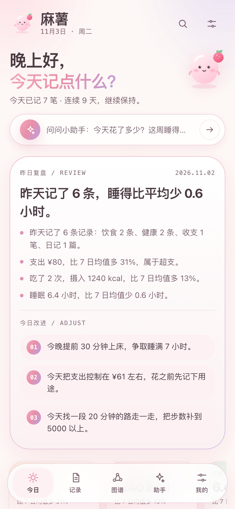 | 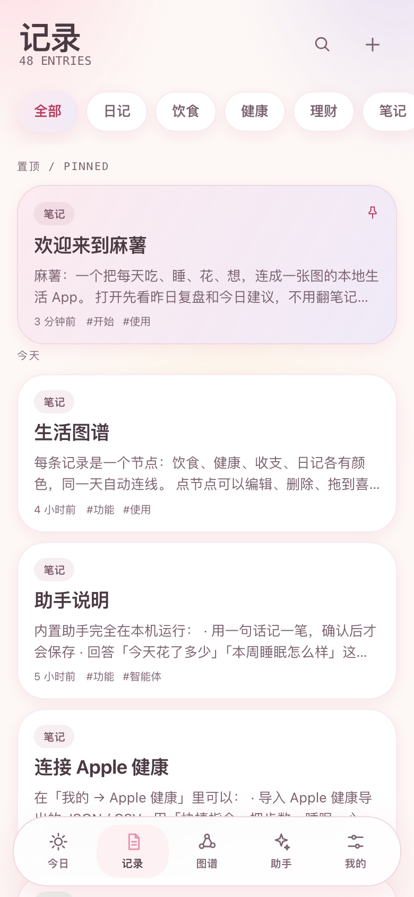 | 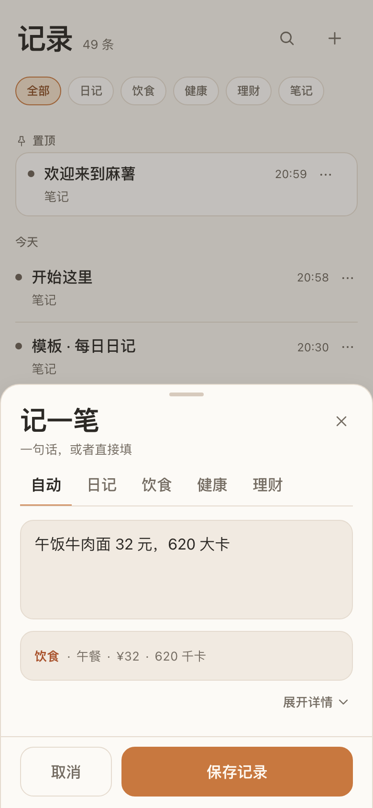 |

| 图谱（仪表盘） | 助手 | 编辑器（预览） |
| :---: | :---: | :---: |
| 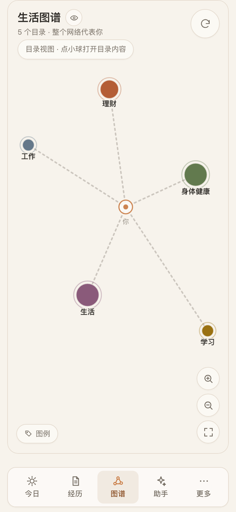 | 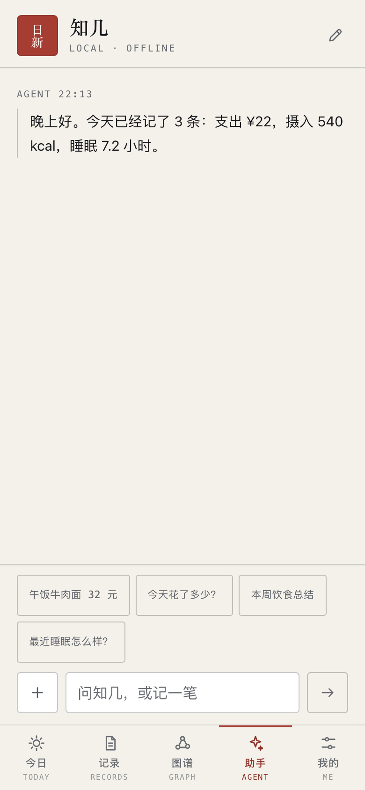 | 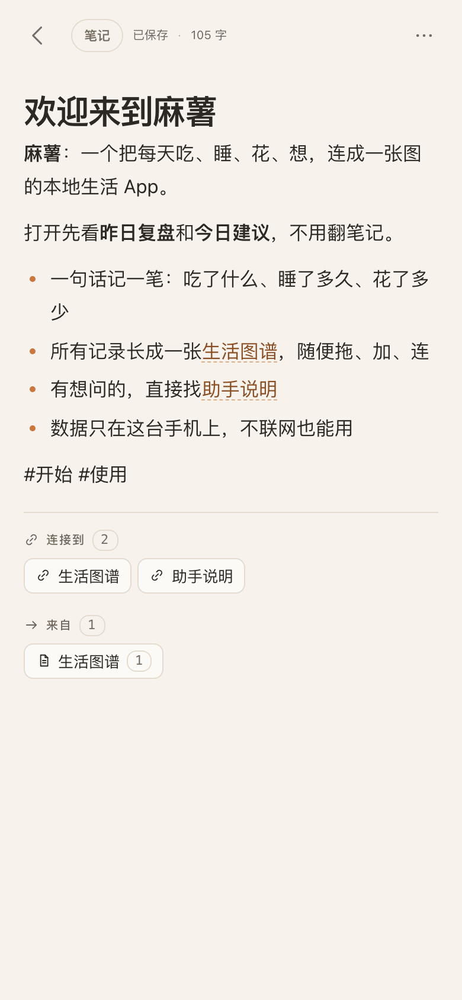 |

| 编辑器（编辑） | 搜索 | 我的 |
| :---: | :---: | :---: |
| 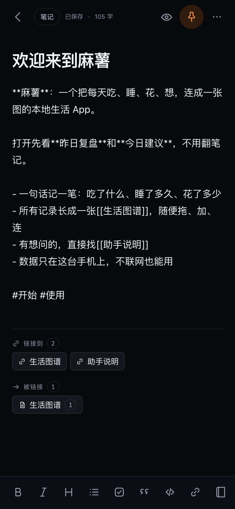 | 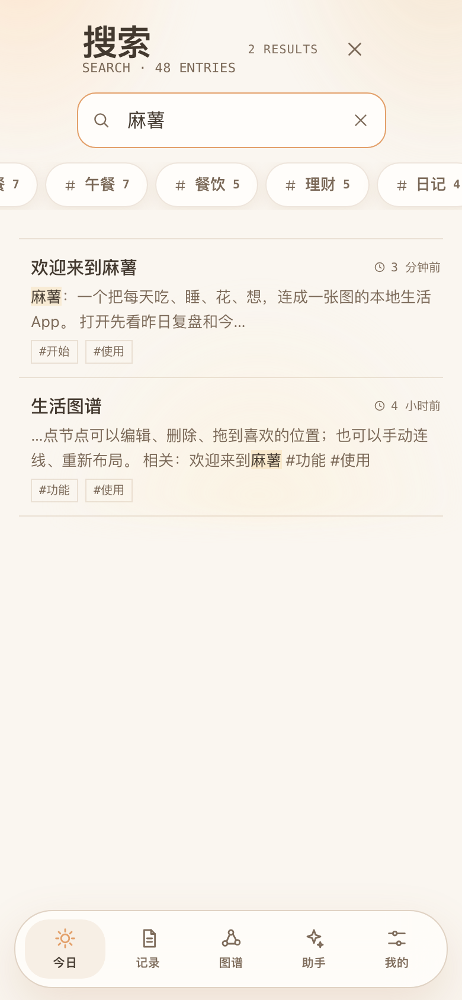 | 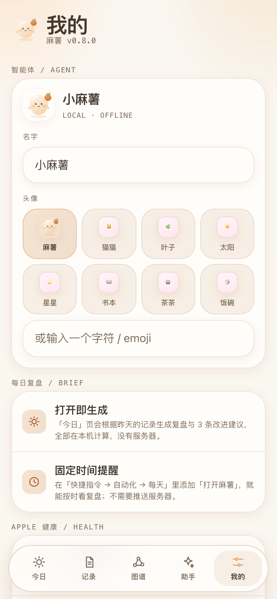 |

| 装到 iPhone 上 | 今日（深色） | 空记录 |
| :---: | :---: | :---: |
| 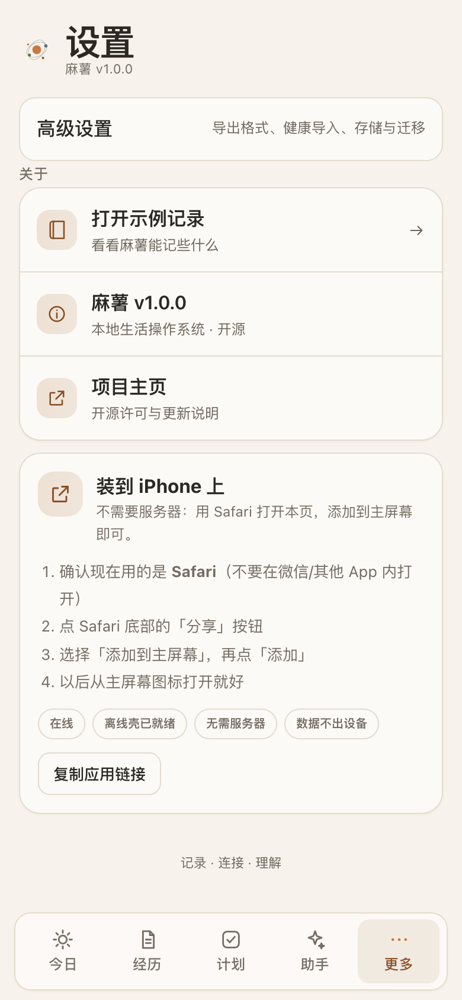 | 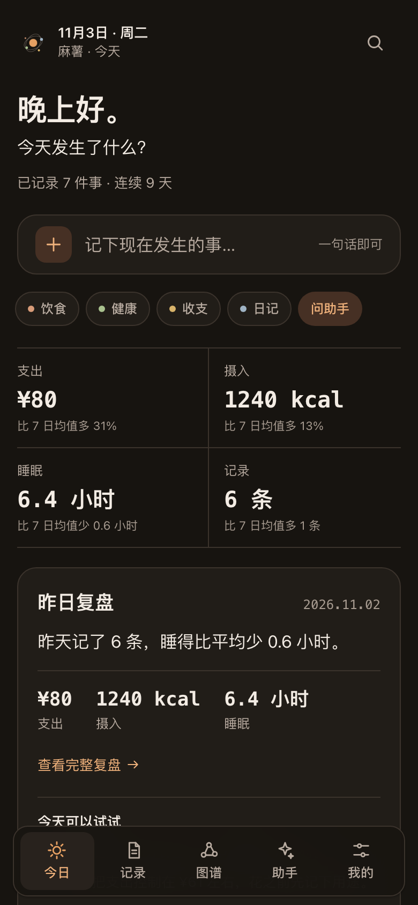 | 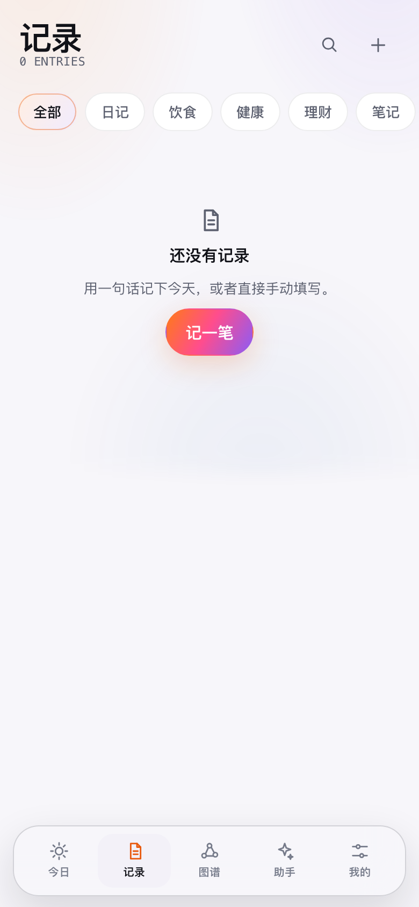 |

## 数据与隐私

- **没有后端、没有账号、没有遥测。** 应用不依赖服务端接口；静态文件由 GitHub Pages 托管。运行时的网络访问只来自加载应用自身的静态文件，以及你在笔记里主动写入的外链/图片。
- **记录保存在设备本地。** 默认 IndexedDB（数据库 `rixin`，schema v2），不可用时回退 localStorage；首次加载会请求持久化存储权限，降低被自动清理的概率。
- **Apple 健康数据只在设备上解析。** 导入的 JSON/CSV 或快捷指令 URL 数据不会上传；解析、单位换算和同日去重都在浏览器内存中完成，随后写入本地记录。
- **旧数据会自动迁移。** 更早版本使用过不同的内部代号与数据库名（`mochi` / `inkstone`），0.4 会在首次打开时把记录与偏好迁移到 `rixin`，成功写入后才删除旧副本；旧版 JSON 备份也兼容导入。迁移前仍建议先导出一份备份。
- **每台设备、每个地址都是独立的库。** 浏览器按 origin 隔离数据；固定用同一个地址访问，不要假定 Safari 页面和主屏幕应用会自动同步。
- **应用壳缓存不含记录。** Service Worker 只缓存 HTML/CSS/JS 等静态资源（缓存 `rixin-v1`），IndexedDB / localStorage 中的记录不会被写入缓存。
- **生活数据比较敏感。** 收支、体重、睡眠都是私人信息；浏览器存储不是端到端加密的，请像保护任何本地文件一样保护设备。导出的 JSON/Markdown 是**明文**，请妥善保管；iCloud 只是你选择的文件存放位置，应用不做 iCloud 同步。
- **删除要谨慎。** 清除 Safari / 网站数据会删除记录；删除主屏幕图标通常只是移除入口，不保证删除数据。删除前请先导出 JSON 备份。

更完整的说明见 [docs/PRIVACY.md](docs/PRIVACY.md)。

## 给开发者（可选）

普通用户不需要这些。环境要求：**Node.js 22 LTS 或更新**（Vite 8 最低 Node 20.19，Vitest 5 需要 Node 22.12+；CI 使用 Node 22）。

```bash
git clone https://github.com/Frank-max610/rixin-notes.git
cd rixin-notes
npm install
npm run dev        # http://localhost:5173
npm run build      # 类型检查 + Vite 构建 + 注入 Service Worker 预缓存清单
npm run preview    # 预览构建（http://localhost:4173）
```

脚本：`dev` / `build`（含 `scripts/sw-precache.mjs`）/ `preview` / `typecheck` / `test` / `test:watch` / `share`（仅开发者局域网调试）/ `icons`（Python + Pillow）/ `splash`（Python + Pillow）/ `qr` / `screenshots`（本机 Chrome）。开发者环境、测试与提交规范见 [CONTRIBUTING.md](CONTRIBUTING.md)。

## 项目结构

```text
rixin-notes/
├── .github/workflows/
│   ├── ci.yml                    # GitHub Actions：typecheck + test + build
│   └── deploy-pages.yml          # 推 main 自动构建并发布 GitHub Pages（零服务器）
├── docs/
│   ├── ARCHITECTURE.md           # 架构、数据流、迁移与扩展点
│   ├── PRIVACY.md                # 隐私说明
│   └── screenshots/              # 12 张应用截图 + npm run qr 生成物
├── public/
│   ├── icons/                    # 朱砂印章 PWA 图标（npm run icons 生成）
│   ├── splash/                   # iPhone 启动图（npm run splash 生成）
│   ├── manifest.webmanifest      # PWA 清单
│   └── sw.js                     # Service Worker（构建后注入 hash 资源清单）
├── scripts/
│   ├── make_icons.py             # 生成 PWA 图标（Python + Pillow）
│   ├── make_splash.py            # 生成 iPhone 启动图（Python + Pillow）
│   ├── sw-precache.mjs           # 构建后把 hash 资源写入 sw.js 的 PRECACHE
│   ├── qr.mjs                    # 生成局域网二维码 PNG
│   ├── screenshots.mjs           # 用本机 Chrome 截取 README 截图
│   └── serve.mjs                 # 局域网静态服务（仅开发者调试）
├── src/
│   ├── components/               # BrandSeal、Sparkline、AgentAvatar、GraphView、CaptureSheet…
│   ├── screens/                  # TodayScreen（今日）、RecordsScreen（记录）、EditorScreen、SettingsScreen（我的）
│   ├── lib/                      # 核心逻辑（纯函数 + 浏览器适配层）
│   │   ├── types.ts              # 数据模型（Note / NoteMeta / NoteKind / AgentPersona…）
│   │   ├── kinds.ts              # 记录类型词表、颜色、默认标题与摘要
│   │   ├── links.ts              # wiki 链接、标签、反向链接
│   │   ├── markdown.ts           # markdown-it 渲染管线
│   │   ├── insights.ts           # 生活统计：日/周汇总、健康序列、分类支出
│   │   ├── brief.ts              # 今日简报：昨日复盘 + 今日改进 + 7 日趋势
│   │   ├── health.ts             # Apple 健康 JSON/CSV/URL 解析、单位换算与去重草稿
│   │   ├── agent.ts              # 本地助手：解析、问答与建议（纯规则）
│   │   ├── search.ts             # 全文搜索（纯函数）
│   │   ├── graph.ts              # 图谱构建与力导向布局（纯函数）
│   │   ├── db.ts                 # IndexedDB `rixin` v2 + 旧库迁移 + localStorage 回退
│   │   ├── store.ts              # useNotes() 单一状态源
│   │   ├── prefs.ts              # 主题、引导、助手人设/印记、安装提示
│   │   ├── seed.ts               # 首次运行的演示记录
│   │   ├── exportImport.ts       # JSON（vault v2，`app: rixin`）/ Markdown 导入导出
│   │   ├── format.ts             # 时间 / 字节 / 数字格式化
│   │   └── useRoute.ts           # 轻量 hash 路由
│   ├── styles/                   # tokens.css（纸墨/朱砂/仪表盘）、base.css、app.css
│   ├── App.tsx                   # 应用外壳：路由、主题、快速记录、图谱、助手、Apple 健康导入
│   └── main.tsx                  # React 挂载入口 + Service Worker 注册
├── tests/                        # Vitest 单元测试（9 个文件 / 202 个用例）
├── index.html                    # HTML 入口、iOS meta、apple-touch-startup-image
├── package.json
├── tsconfig.json
├── vite.config.ts
├── vitest.config.ts
├── CONTRIBUTING.md
├── LICENSE
└── README.md
```

## 技术选型

| 层面 | 选择 | 原因 |
| --- | --- | --- |
| UI | **React 19 + TypeScript strict** | 组件化、hooks 管理状态；strict 把问题挡在编译期 |
| 构建 | **Vite 8** | 快速开发服务器与静态构建；`base: './'` 让产物可部署到任意路径 |
| Markdown | **markdown-it 15** | 可靠、可扩展的 CommonMark 实现；关闭 `html`，从源头避免注入 |
| 存储 | **原生 IndexedDB（`rixin`，schema v2）+ localStorage 回退** | 零额外依赖；旧库一次性迁移，旧备份可导入 |
| 状态 | **单一 `useNotes()` hook** | 内存乐观更新 + 防抖写入，输入不等 I/O |
| 简报 | **纯函数 `buildDailyBrief`** | 规则确定、可测试；昨日 vs 最近 7 个有记录日，本地生成 |
| 健康导入 | **纯函数解析 + 草稿去重** | JSON/CSV/URL 三种输入，单位换算与同日 `replaceId` 更新 |
| 图谱 | **Canvas 2D + 确定性力导向 + 深色仪表盘** | 纯函数布局；绘制与交互分离，支持完整编辑 |
| 视觉 | **手写 CSS + 设计变量** | 纸墨、朱砂、宋体标题、等宽标签；不引入 UI 框架 |
| 测试 | **Vitest（node 环境）** | brief / health / agent / graph 等纯逻辑可直接测 |
| 托管 | **GitHub Actions → GitHub Pages** | 免费静态托管，推 `main` 自动发布；维护者零服务器运维 |

运行时依赖只有 `react`、`react-dom`、`markdown-it` 三个；没有路由库、状态库、UI 框架和后端。

## 部署（维护者视角）

- **GitHub Pages（唯一必需）**：`.github/workflows/deploy-pages.yml` 在推送到 `main` 或手动 `workflow_dispatch` 后构建并发布，线上地址为 <https://frank-max610.github.io/rixin-notes/>。`base: './'` 保证子路径正常加载，hash 路由不需要服务端 rewrite。
- **GitHub 只是免费的静态托管。** 没有服务器要维护、没有数据库要备份、没有密钥或环境变量；维护者要做的只是推代码。用户从演示链接安装到主屏幕，数据都在各自手机上。
- **可选其他静态托管**：`npm run build` 后把 `dist/` 上传到任意静态托管（Vercel、Netlify、Cloudflare Pages 等），仍然不需要服务器。
- **局域网 `npm run share` 只是开发者调试**，不是用户安装路径。

## FAQ

### 「日新」是什么意思？

取自《礼记·大学》「苟日新，日日新，又日新」：每天更新一点。产品把「记录 → 复盘 → 今天的改进」做成每天打开的第一屏，而不是把一堆笔记丢给你自己整理。

### 为什么改名叫日新？

0.4.0 是一次品牌与视觉重构：从早期的内部代号和旧品牌，统一为「日新 / Rixin」，并配了编辑设计的纸墨界面和朱砂印章。旧版本的数据会自动迁移，旧版 JSON 备份也能导入，不需要手动导出再重建。

### 数据会丢吗？

正常使用不会。旧数据库会在首次打开时迁移到 `rixin`，只有成功写入后才删除旧副本；应用会请求持久化存储权限，保存失败时会提示导出备份。风险主要来自手动清除 Safari / 网站数据、无痕模式或空间不足——**最稳妥的习惯仍然是定期导出 JSON 备份**。

### Apple 健康能自动同步吗？

不能直接自动同步。网页应用没有 HealthKit 权限，日新提供两条零服务器路径：①「我的 → Apple 健康 → 导入健康数据」导入 Apple 健康导出（或快捷指令生成）的 JSON/CSV；②复制 `?health=` 快捷指令导入链接，在快捷指令里拼接数据后打开应用自动导入。想真正直连 HealthKit，需要原生 iOS 壳（Xcode + HealthKit），这是路线图里的可选项，当前仓库不包含。

### 真正的推送提醒怎么办？

日新没有推送服务器（也不打算有）。固定时间提醒用 iOS 自带的「快捷指令 → 自动化 → 每天」添加「打开日新」：到点由系统打开应用，简报在本地生成。这是操作系统的能力，应用不需要后台服务。

### 为什么不是 App Store 应用？

PWA 不需要 Apple 开发者账号、签名和审核，更新也简单：推代码 → Pages 发布 → 联网打开即更新。代价是没有应用商店的发现渠道，且受 Safari 的 PWA 能力限制。路线图里保留了可选的 Capacitor 原生壳作为以后上架 App Store 的形态，但当前不存在。

### 需要服务器吗？

不需要。整个应用是静态 HTML/CSS/JS，由 GitHub Actions 自动发布到 GitHub Pages；GitHub 提供免费静态托管，维护者不做任何服务器运维。

### 可以离线用吗？

安装到主屏幕并完成首次加载后可以。Service Worker 会缓存应用壳（缓存 `rixin-v1`），断网时记录、简报、助手、图谱都能继续工作；联网时重新打开会自动加载新版本。

### 换手机 / 同步怎么办？

没有云同步。在旧手机「我的 → 导出全部记录（JSON）」，分享面板存到「文件」或 iCloud 云盘，再在新手机「导入记录」（合并或替换）。这是手动备份/迁移，不是实时同步；应用不接 iCloud API。

### 苹果能用吗？

能，而且这就是为 iPhone / iPad 做的：Safari 安装到主屏幕、七种尺寸启动图、standalone 无地址栏、安全区、16px 表单避免聚焦缩放、Web Share 导出到「文件」/ iCloud 都已处理。其他浏览器可以打开网页版，但支持与测试范围只覆盖 iPhone / iPad 的 Safari 与主屏幕模式。

### 助手会联网吗？会不会把我的记录发给大模型？

不会。助手是 `src/lib/agent.ts` 里的本地规则引擎，简报是 `src/lib/brief.ts` 的确定性计算；没有网络请求、没有模型 API，也不会上传记录。它们不是大语言模型，回答范围由规则决定——可预测、可测试，因此不如通用聊天模型灵活。

### 能记些什么？

| 类型 | 可以记 | 结构化字段示例 |
| --- | --- | --- |
| 饮食 | 「午饭牛肉面 32 元 620 大卡」 | 餐次、热量、菜品、金额 |
| 健康 | 「体重 52.4 kg」「睡了 7 小时」「走了 8300 步」 | 指标、数值、单位 |
| 理财 | 「地铁 6 元」「工资 8500」 | 收支方向、金额、分类 |
| 日记 | 「今天有点累，但完成了报告」 | 心情 |
| 笔记 | 普通 Markdown 长文、清单、计划 | 标题、正文、标签、链接 |

### 图谱怎么改？

- **移动**：拖动节点，松手后位置保存；「重新布局」清空手动位置。
- **编辑 / 删除**：点节点选中，打开记录面板改标题、类型、结构化字段和手动连线，也可以删除。
- **添加 / 连线**：工具栏「添加」后点画布空白处新建；「连线」后依次点两个节点。
- **缩放**：双指 / 滚轮缩放、拖动画布、适应画布。

### 和 Obsidian 有什么区别？

Obsidian 是通用 Markdown 知识库，插件生态成熟，文件存在本地文件夹；日新更小、更安静，iPhone-first，面向「生活记录 + 每日复盘」：有结构化字段、每日简报、Apple 健康导入和可编辑生活图谱，助手与简报完全离线。它没有插件生态、没有本地文件夹 vault、没有内置同步。需要文件级 Markdown、插件和多端同步时，Obsidian 仍然更合适。

### 支持哪些 Markdown 语法？

标题、粗体/斜体、删除线、引用、有序/无序列表、任务清单（`- [ ]`，预览中只展示状态）、表格、围栏代码块、行内代码、链接、`[[wiki 链接]]`、`#标签`。出于安全考虑禁用原始 HTML；暂时没有代码高亮、图片上传或文件夹层级（见路线图）。

### 如何删除所有数据？

「我的」页提供「清空全部记录」；也可以在 iOS 设置 / Safari 里清除该网站的数据。删除前请先导出 JSON 备份，操作不可恢复。

## 路线图

已完成（0.4.0）：

- [x] 品牌与编辑设计重构：日新 / Rixin、朱砂印章 logo、纸墨界面、宋体标题、等宽标签、扁平导航
- [x] 首屏改为「今日」仪表盘：昨日复盘 + 今日改进 + 四张 7 日趋势卡（sparkline）
- [x] 每日简报引擎 `brief.ts`：确定性规则，本地生成，无推送服务器
- [x] 「记录」独立标签页：按天分组、类型筛选、空状态
- [x] 硬核仪表盘风格生活图谱：始终深色、28px 网格、霓虹类型色、三类边、幽灵菱形、完整编辑
- [x] 助手「知几」与 8 种抽象印记头像，自定义名字/字符
- [x] Apple 健康 JSON / CSV / 快捷指令 URL 导入：单位换算、HealthKit 别名、同日去重
- [x] 存储迁移：旧数据库（`mochi` / `inkstone`）与偏好一次性迁移到 `rixin`；旧备份兼容导入
- [x] Service Worker 缓存 `rixin-v1`，构建自动注入 hash 资源清单
- [x] iPhone 主屏幕安装、启动图、Web Share 导出、离线/联网提示、零服务器部署

计划中：

- [ ] 原生 iOS 壳（Xcode + HealthKit）：直接读健康数据，需要 Apple 开发者账号与审核
- [ ] 可选的本地小模型（local LLM）适配器：仍在设备本地运行、默认关闭
- [ ] 更丰富的图表页（支出结构、体重/睡眠趋势）
- [ ] iCloud / 「文件」备份体验改进（目前是手动分享 JSON）
- [ ] 云同步 / WebDAV / Git 备份
- [ ] 导入 Markdown 合集（目前导入只支持 JSON）
- [ ] 本地文件夹 vault（File System Access API）
- [ ] 图片 / 附件上传、代码块语法高亮
- [ ] 插件系统与主题、英文界面（i18n）、UI 交互测试

## 参与贡献

欢迎 issue、PR 和真实使用反馈。开发环境、代码风格、测试要求和提交规范见 [CONTRIBUTING.md](CONTRIBUTING.md)。

```bash
npm run typecheck && npm test && npm run build
```

## 许可证

[MIT](LICENSE) © 2026 日新 contributors

---

## English

**Rixin (日新)** is a local-first, iPhone-first life journal and Markdown notebook. Its name comes from the *Book of Rites* (《礼记·大学》): “苟日新，日日新，又日新” — renew yourself every day, and keep renewing.

- **No server, no account.** The whole app is a static site auto-deployed by GitHub Actions to GitHub Pages (free static hosting; the maintainer runs zero server operations). Open it in Safari, Share → Add to Home Screen, and it works offline after the first load.
- **Dashboard first.** The home screen reviews yesterday with factual bullets, suggests 2–3 concrete adjustments for today, and shows four seven-day sparklines (spend / calories / sleep / records). The full list lives in the Records tab.
- **Flat navigation**: Today / Records / Graph / Agent / Me. No search tab — search opens from the header. Calm editorial design: paper & ink, vermilion accent, Songti display titles, monospaced meta labels, 1px hairlines, 3–10px radii, no mascots or candy styling.
- **A hardcore-tech life graph**: an always-dark instrument panel with a 28px grid, neon kind colours, monospaced labels and 1px edges (wiki solid, manual brighter with a midpoint tick, same-day dashed). Ghost notes are dashed diamonds. Editing is preserved: select, edit, add, drag, connect, reset layout, fit, pinch-zoom.
- **A local agent named 知几 (Zhiji)** with eight abstract sigil avatars (seal, initial, ring, square, triad, spark, wave, grid) or a custom character, plus a custom name. Fully local rule-based heuristics — not an LLM, no model API, no telemetry.
- **Apple Health / Watch import**: parse Apple-Health-style JSON, CSV or a `?health=` Shortcuts payload, with unit conversion (lb/g/L/min), HealthKit aliases, and same-day deduplication. Honest limit: a web app cannot read HealthKit directly — the current paths are file import and Shortcuts; a native iOS shell is a roadmap option, not included.
- **Storage migration**: the database is now `rixin`; old local data is adopted once and removed after a successful write, and old JSON backups still import. Service worker cache `rixin-v1`.
- **Daily brief with no push server**: in-app deterministic heuristics; real scheduled reminders are an iOS Shortcut personal automation that opens the app. Zero server operations.

Try the [live demo](https://frank-max610.github.io/rixin-notes/) in Safari and add it to your Home Screen. MIT licensed — read [docs/ARCHITECTURE.md](docs/ARCHITECTURE.md) for the design and [CONTRIBUTING.md](CONTRIBUTING.md) to get involved.
